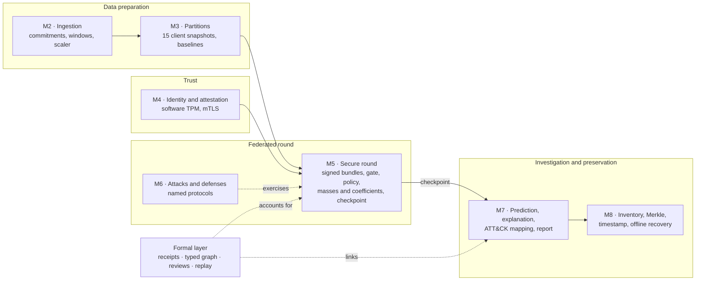

# Architecture map and reading guide

This page is the entry point for a first visit. It shows what the framework
does, how one federated round becomes verifiable evidence, and where the code,
procedures and results of each stage are located. Terms are defined in the
[glossary](GLOSSARY.md).

## What the framework does

Several organizations train a shared intrusion-detection model on network logs
without centralizing the logs. Every step that can influence the model or an
investigative conclusion produces a signed artifact linked to its inputs:

1. **Ingest** public Zeek logs under commitment and derive feature windows (M2).
2. **Partition** them into fifteen client snapshots and train clean baselines (M3).
3. **Enroll** clients with software-TPM identities and attestation (M4).
4. **Run secure rounds**: clients sign their updates; the server checks identity,
   context, freshness and attestation, applies the admission policy and records
   the weight of every update in the new checkpoint (M5).
5. **Attack and defend** the federation under named protocols (M6).
6. **Investigate**: predict, explain, map to candidate ATT&CK tactics and report,
   with links back to source records (M7).
7. **Preserve** the chain: inventory, Merkle commitment, timestamp and offline
   recovery (M8).

A formal layer runs across stages 4 to 7: receipts account for submissions, a
typed graph records which artifacts depend on which submissions, signed reviews
add later judgments without rewriting history, and counterfactual replay
measures the effect of removing contributions.

## One round, step by step

| Step | Actor | Artifact produced | Verified by |
| --- | --- | --- | --- |
| 1 | Server | Round context: campaign, round number, base checkpoint digest | Clients before training |
| 2 | Client | Local update and signed bundle bound to round, base and snapshot | Server gate |
| 3 | Client | Signed receipt of its own submission | Inventory coverage check |
| 4 | Client TPM | Fresh attestation Quote | M4 appraisal |
| 5 | Server | Gate result per update (identity, signature, context, replay, attestation) | Round verifier |
| 6 | Server | Admission action, effective mass and coefficient per update | Round verifier recomputes them |
| 7 | Server | New checkpoint, or an explicit failed round | Byte-for-byte aggregation replay |
| 8 | Analyst | Signed review appended to the ledger | Ledger verifier; history unchanged |

A failed mandatory gate always gives zero weight, whatever the statistical
score. A quarantined update keeps its record and can still appear in the
decision history.

## Where each stage lives

| Stage | Main modules in `src/fl_forensics/` | CLI commands (`fl-forensics …`) | Procedure | Example evidence |
| --- | --- | --- | --- | --- |
| M1 | `acquisition.py`, `demo.py`, `verification.py` | `demo`, `verify`; `make smoke` | [Architecture contract](../ARCHITECTURE.md) | Fixture only |
| M2 | `dataset24.py`, `dataset24_parquet.py`, `preprocessing.py`, `lineage.py` | `m2-*`; `make m2` | [Data24 procedure](../milestones/DATASET_UWF_ZEEKDATA24.md) | Controlled local workspace |
| M3 | `federated_partitioning.py`, `federated_training.py`, `protean*.py` | `m3-*`; `make m3` | [Federated baseline](../milestones/MILESTONE_3_FEDERATED_BASELINE.md), [PROTEAN](../milestones/MILESTONE_3_PROTEAN.md) | [m3-multiseed-v2](../../results/milestones/m3-multiseed-v2/README.md) |
| M4 | `trust.py`, `attestation.py`, `tpm_adapter.py`, `mtls.py` | `m4-*` | [Trust deployment](../milestones/MILESTONE_4_TRUST_DEPLOYMENT.md) | [Real attestation failure](../measurement/REAL_ATTESTATION_FAILURE.md) |
| M5 | `secure_round.py`, `admission.py`, `composite_admission.py`, `round_derivation.py`, `checkpoint_verification.py` | `m5-*` | [Secure multiround](../milestones/MILESTONE_5_SECURE_MULTIROUND.md) | [Round derivation](../formal/ROUND_DERIVATION.md) |
| M6 | `byzantine*.py`, `distributed_backdoor.py`, `literature_baselines.py`, `robust_bounded_aggregation.py` | `m6-*` | [Byzantine experiments](../milestones/MILESTONE_6_BYZANTINE_EXPERIMENTS.md) | [Experimental findings](EXPERIMENTS.md) |
| M7 | `prediction_bundle.py`, `explanation_bundle.py`, `attack_mapping.py`, `investigation_report.py` | `m7-*` | [Investigation](../milestones/MILESTONE_7_INVESTIGATION.md) | [m7 investigation](../../results/milestones/m7-m6-disagreement-investigation-local-test-v1/README.md) |
| M8 | `preservation.py`, `merkle.py`, `timestamp_anchor.py`, `recovery.py`, `final_preservation.py` | `m8-*` | [Preservation](../milestones/MILESTONE_8_PRESERVATION.md) | [m8 preservation](../../results/milestones/m8-m6-disagreement-preservation-local-test-v1/README.md) |
| Formal layer | `submission_evidence.py`, `ingestion_coverage.py`, `campaign_derivation.py`, `review_ledger.py`, `counterfactual_round.py`, `retraining_replay.py`, `system_chain.py` | `ingestion-*`, `campaign-*`, `review-*`, `counterfactual-*`, `retraining-*`, `witness-*`, `system-chain-verify` | [Formal theorems](../formal/FORMAL_MODEL_THEOREMS.md) | [Final formal correspondence](../../results/chain-witness/revision-final-formal-correspondence-v2/README.md) |

Docker Compose files (`compose.m4.yaml`, `compose.m5.yaml`) start the
software-TPM clients for M4 and M5. Configurations are in `configs/`, one file
per profile.

## Reading paths

| Goal | Read in this order | Then run |
| --- | --- | --- |
| Understand the contribution | This page → [Glossary](GLOSSARY.md) → [Framework](FRAMEWORK.md) → [Status](../STATUS.md) | – |
| Check the formal model | [Formal theorems](../formal/FORMAL_MODEL_THEOREMS.md) → [Requirements](REQUIREMENTS.md) | `make test-formal` |
| Check the thesis results | [Experimental findings](EXPERIMENTS.md) → [Results overview](../../results/README.md) | `make thesis-evidence` |
| Reproduce the data foundation | [Reproducibility](REPRODUCIBILITY.md) | `make setup`, `make foundation` |
| Inspect admission policies | [Admission and defenses](ADMISSION.md) | `make test` |
| Find an older protocol | [Reference catalogue](../REFERENCE_INDEX.md) | – |

Documents in the root of `docs/` are versioned records of a specific release.
The pages in `docs/guide/` and `docs/STATUS.md` describe the current state.
