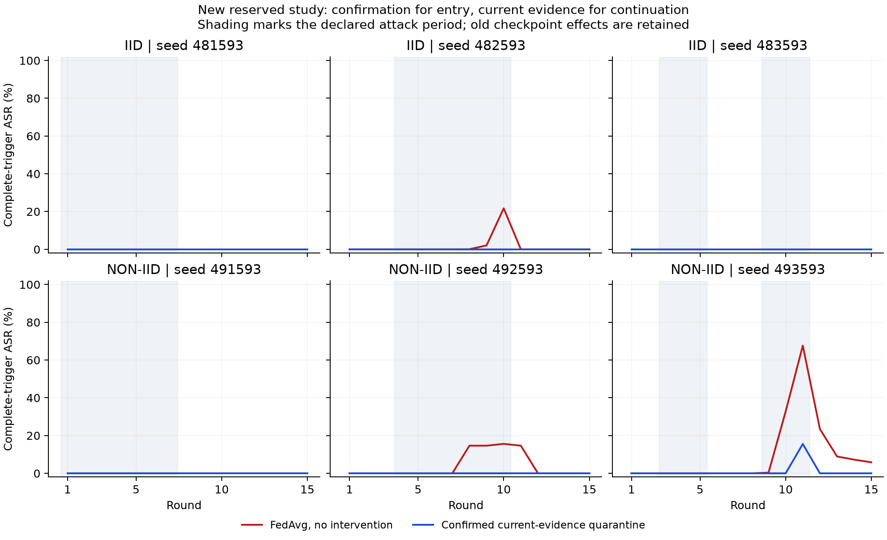
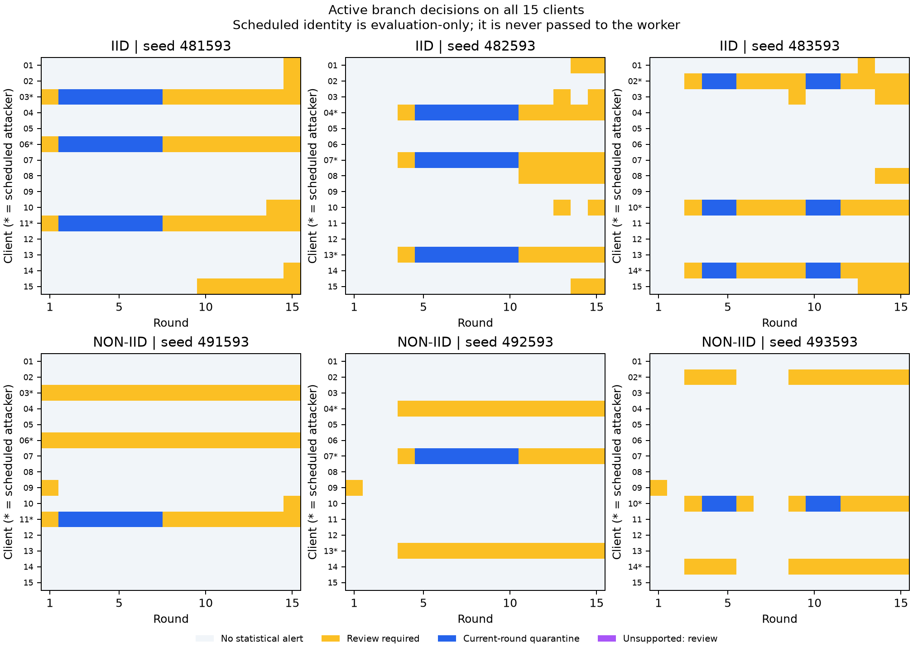

# Confirmed current-evidence quarantine and immediate statistical release

Date: 2026-11-03. Branch: `revision/derivation-protocol`.

## Outcome

The new experimental `fl_forensics.current_evidence_policy` module fixes the
quarantine lifecycle: two consecutive strong current observations are required
for entry, and strong current evidence is required for every continuation.
Cumulative evidence remains available for review and priority; it cannot
authorize or prolong quarantine. Original predictor models and all score
thresholds are unchanged.

The full predeclared screening criteria pass on the new reserved study:

| Criterion, counting shadow proposals and actual active actions | Result |
| --- | --- |
| at_least_one_poisoned_update_proposed_per_attacked_episode | True |
| no_active_quorum_failure | True |
| zero_after_cessation_clean_source_proposals | True |
| zero_never_attacker_quarantine_proposals | True |

Across all 24 new episodes, the primary rule produces
**0 never-attacker quarantine proposals**,
**0 clean-source proposals after final attack cessation**, and
**0 clean-source proposals during gaps between bursts**.
The latter is measured separately from the predeclared post-cessation criterion.
The six active attacked episodes quarantine
**64/120 (53.33%)**
actually poisoned updates. Review is not counted as a successful quarantine.
The first-poisoned-update screening criterion is weak and does not establish
full attacker membership, complete protection or a production false-positive
guarantee. The policy remains experimental and is not connected to live admission.

## Why the action rule changed

The preceding frozen study showed that cumulative-sequential quarantine was
inferior to an instantaneous comparator on the same shadow prefixes: 80/162
versus 119/162 poisoned updates, three versus one never-attacker proposals, and
41 versus zero clean-source proposals after cessation. The old instantaneous
false proposal was isolated. These old episodes are now explicitly development
data, not a new held-out result. A replay of the new rule on those stored
observations is preserved in `development-replay.json`; it does not retrain
active trajectories or qualify deployment.

The new rule addresses the measured mechanism without lowering thresholds.
For client i, define `H[i,t]` as supported, gate-compatible current evidence with
both calibrated standardized view risks strictly above their original
instantaneous limits. The action is exactly:

`Q[i,t] = H[i,t] AND H[i,t-1]`.

Every unsupported or non-high round resets confirmation. A single peak goes to
review. A second consecutive strong observation can enter quarantine. A
previously quarantined client leaves statistical quarantine immediately when
current dual-view evidence is no longer high. Reentry needs a new consecutive
pair. All clients keep submitting in all rounds; there is no permanent ban.
This introduces a deliberate first-update delay and can miss short or weak
attacks. The empirical comparison below quantifies that tradeoff.

The old CUSUM recurrence is retained for review and review priority only. It
cannot substitute for `H[i,t]`, even after an arbitrarily large historical score.
Release is not a semantic benign label and does not override a failed mandatory
gate. A released contribution may still be protocol-rejected; an unsupported
context requires review/abstention. Influence mass changes review priority,
never the high-evidence condition or gate precedence.

## Formal and implementation boundaries

The quarantine-subset property follows directly from the action rule:
`Q[t]` is a subset of current high candidates and previous-round high candidates.
Therefore a stale cumulative score alone cannot quarantine a contribution.
For a previously quarantined contribution, `NOT H[i,t]` implies statistical
release at t. With fixed calibration and identical observed prefixes, induction
over the deterministic confirmation, evidence and digest states establishes
prefix invariance. These are input/action properties, not classification
accuracy or semantic-malice theorems.

The new module composes the unchanged evidence engine and exposes a separate
action chain. It enforces exact observation commitments, strict integer round
order and the trusted expected predecessor. Exact retries return the original
result and do not count a peak twice; changed retries fail. Mandatory failures
retain zero mass. Changed eligibility invalidates fixed-cohort statistical
support; unsupported observations break confirmation. Quorum loss never
re-admits excluded contributions. Hash chaining assumes an externally trusted
head; the analyst signature is not an independent witness or trusted timestamp.

Both views derive from the same source updates and are correlated. Agreement
is corroboration under this rule, not two independent statistical tests. Clean
calibration and the cohort identities remain trust assumptions. No proof of
malicious intent, collusion or perfect update-only identification is claimed.

## Frozen prospective protocol

Before new training, the source, worker, controller, previous completion,
unchanged calibration and unchanged predictor models were pinned. The fresh
study has three IID seeds (481593–483593), three non-IID seeds
(491593–493593), clean/distributed modes, and shadow-FedAvg/active-current-evidence
branches: **24 episodes of 15 rounds**, with 15 clients each.
Attacker triplets are 03/06/11, 04/07/13 and 02/10/14. Schedules are 1–7,
4–10 and two bursts 3–5/9–11. Roles modify features 13, 17 and 24. The later
quiet rounds and the pause between bursts test release and reconfirmation.

The committed Data24 snapshots, original local Adam protocol and row-count
FedAvg weights are retained. IID/non-IID use separate fixed-cohort reference
models; this is replication within fixed partitions, not a new independent
dataset. No model or threshold is retuned on the new outcomes. The original
clean response calibration includes ordinary clean trajectories and historical
matched-state clean local responses at affected checkpoints; those are
development/null controls, not prospective independent campaigns.

The simulator/evaluator can access source rows and attack plans. The persistent
Docker decision worker cannot: it has no network, read-only code/model/calibration
mounts and a current-request inbox. It receives an opaque stream identifier,
public cohort, current model observations, gates, masses and predecessor. It
does not receive seeds, mode, branch, attack identities, rows or future frames.
The two original rules are recorded as shadow proposals on each identical
prefix; neither is assigned an alternative active-history outcome here.

## New current-round actions

| Partition | Seed | Attack rounds | Poisoned updates quarantined | Never-attacker proposals | After cessation | During clean gap | First actual-poison quarantine delays, attacker order |
| --- | --- | --- | --- | --- | --- | --- | --- |
| iid | 481593 | 1,2,3,4,5,6,7 | 18/21 (85.71%) | 0 | 0 | 0 | 1, 1, 1 |
| iid | 482593 | 4,5,6,7,8,9,10 | 18/21 (85.71%) | 0 | 0 | 0 | 1, 1, 1 |
| iid | 483593 | 3,4,5,9,10,11 | 12/18 (66.67%) | 0 | 0 | 0 | 1, 1, 1 |
| non-iid | 491593 | 1,2,3,4,5,6,7 | 6/21 (28.57%) | 0 | 0 | 0 | none, none, 1 |
| non-iid | 492593 | 4,5,6,7,8,9,10 | 6/21 (28.57%) | 0 | 0 | 0 | none, 1, none |
| non-iid | 493593 | 3,4,5,9,10,11 | 4/18 (22.22%) | 0 | 0 | 0 | none, 1, none |

Delays count rounds from actual poisoning onset. `none` means no poisoned update
was quarantined for that client; a later review does not count as detection.
Per-client `burst_evaluations` in `online-evaluation.json` separately records
each burst, including a missed first burst followed by a detected second burst.
Across active cases there are 16 statistical-release transitions and
248 review client-rounds, including
80 concerning never-attacking clients. This workload is a cost even
when erroneous quarantine counts are zero. All supported/unsupported counts,
gate qualifications and action transitions are preserved.

## Same-prefix comparison

This table uses only the new shadow-FedAvg histories. `current` is the primary
confirmed-current-evidence rule; `sequential` is the preceding cumulative rule.
All three consume exactly the same observations, calibration and source truth.

| Partition | Rule | Poisoned proposals | Poisoned opportunities | Never-attacker proposals | After cessation | During clean gap |
| --- | --- | --- | --- | --- | --- | --- |
| iid | current | 48 | 60 | 0 | 0 | 0 |
| iid | instantaneous | 60 | 60 | 0 | 0 | 0 |
| iid | sequential | 38 | 60 | 0 | 31 | 1 |
| non-iid | current | 15 | 60 | 0 | 0 | 0 |
| non-iid | instantaneous | 19 | 60 | 0 | 0 | 0 |
| non-iid | sequential | 4 | 60 | 0 | 14 | 0 |

The confirmation rule trades first-update sensitivity for resistance to isolated
peaks. The instantaneous comparator can catch an update the new rule leaves for
review. Neither candidate proposal counts nor the active primary outcomes
establish how an unexecuted active comparator would behave. No winner is selected
by partition or attack seed after evaluation.

## Numerical effects and clean references

| Partition | Seed | FedAvg final ASR | Primary final ASR | FedAvg / primary peak ASR | Primary minus FedAvg final macro-F1 | Primary vs all-client clean final parameter L2 |
| --- | --- | --- | --- | --- | --- | --- |
| iid | 481593 | 0.00% | 0.00% | 0.00% / 0.00% | -0.0040 | 1.6828 |
| iid | 482593 | 0.00% | 0.00% | 21.70% / 0.00% | +0.0009 | 1.0874 |
| iid | 483593 | 0.00% | 0.00% | 0.00% / 0.00% | -0.0032 | 1.6136 |
| non-iid | 491593 | 0.00% | 0.00% | 0.00% / 0.00% | -0.0003 | 1.6840 |
| non-iid | 492593 | 0.00% | 0.00% | 15.59% / 0.00% | +0.0004 | 2.0476 |
| non-iid | 493593 | 5.83% | 0.00% | 67.64% / 15.54% | -0.0025 | 4.2019 |

Three of the six no-intervention attacked controls have zero complete-trigger
ASR throughout. Those cases test poisoning-source classification and the action
lifecycle, but cannot demonstrate neutralization of an otherwise effective
complete-trigger attack. In the most affected non-IID case (493593), primary
peak ASR remains 15.54% despite final ASR zero. The attack was therefore not
prevented throughout its trajectory. These limitations are not hidden by the
passing lifecycle screening criteria.

Every-round complete/component-trigger ASR, reference-correct conditional ASR,
untriggered target rate and clean validation metrics are in
`online-trajectories.json`. ASR denominators use non-target validation rows.
No final test set is used. A final score after attack cessation can hide an
earlier compromise; the peak and complete trajectories must also be considered.

The six same-seed clean active/shadow pairs have identical complete checkpoint
histories: **True**.
Attacked pairs include final parameter distances, checkpoint equality and clean
validation prediction disagreements against the all-client clean reference.
After quarantine, participation differs from that reference: distance alone
cannot attribute every model difference wholly to residual poisoning. Conversely,
ASR zero alone does not establish clean-history recovery. Current action does
not rewrite earlier checkpoints; historical remediation still needs its own
matched-participation counterfactual replay.

## Validation and status

The full suite passes **604 tests**, zero failures/errors/skips, with two existing
Typer deprecation warnings (96.70 seconds). Fourteen new tests check
isolated peaks, two-frame entry, immediate release despite huge cumulative
history, reconfirmation, one-view loss, unsupported reset, mandatory rejection,
idempotent retries, prefix invariance, the current-evidence subset, quorum loss,
mass/priority separation, digest integrity and strict round ordering.

The post-study verifier authenticates every episode, checks **5,400 evaluation
local models** against their observable arrays and declared row-set commitments,
independently reconstructs **360 aggregates**, and recomputes **360 primary
prefix decisions**, confirmation streaks, releases, exact aggregation weights
and both shadow comparators. This step adds **5,400 local training calls and
360 actual FL rounds**. Thresholds are reused, so no new calibration training is
counted. Episodes and client-round observations are correlated; they are not
independent Bernoulli trials for a population false-positive guarantee.

The module remains experimental. The study does not establish performance on
adaptive attacks, unseen cohorts, clean concept drift or independent datasets.
Invalid live production payload handling is not exercised by this worker;
mandatory-gate/quorum behavior is covered by focused tests. No fresh TPM campaign,
production admission integration, automatic checkpoint repair or permanent ban
is introduced. Retrospective candidate groups compatible with coordinated
behavior, structural blast radius and separate numerical replay remain the
professor-approved thesis scope.

The 111 pre-existing package files, previous signed evidence, Git index and
22 actual thesis source files are preserved. Repository documentation is in
English. No thesis edit, commit or push is performed. Protocol, execution map,
runtime inspection, source archive, full evaluation and a signed local analyst
closure accompany this report. Numerical payloads remain under
`artifacts/revision-current-evidence-policy-v1`.
