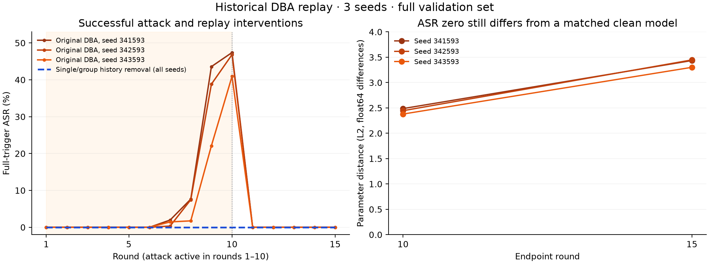

# Effective influence diagnostics and successful DBA replay

Date: 2026-11-03. Repository branch: `revision/derivation-protocol`.
This step changes code and validation evidence. It does not edit the thesis.

## Result

The round-local analysis now separates removal, survivor policy changes and model
changes. A composed verifier recomputes the full historical admission procedure
for every round of a supplied graph before reporting a verified investigation.
The DBA replay now includes a successful attack, all three existing seeds,
full subsequent client retraining and a clean control with matched participation.

The original fixed-population Delta and binary J remain available. They are not
silently redefined. Historical signed evidence and measured source releases remain
immutable; the new analyst code has its own hashes.

## 1. Separate questions, separate diagnostics

Let the original normalized vector be alpha, R the removed submissions,
U the survivors, and beta = sum(alpha_i, i in R). Where the frozen survivor
aggregate is valid, define alpha_F,i = alpha_i / (1-beta), i in U. Let alpha_A
be the normalized vector after rescoring the surviving historical inputs.

The new profile `separated-removal-policy-model-effects-v1` reports:

| Quantity | Question answered |
|---|---|
| Removed original weight beta | How much original aggregation mass was removed? |
| Survivor action-change indicator and fraction | Did any remaining admission action change? |
| Survivor policy TV = 1/2 sum(abs(alpha_A,i - alpha_F,i)) | Did rescoring change normalized weights beyond removal-only renormalization? |
| Direct model distance = norm(theta_F - theta_0) | What changed under frozen decisions? |
| Additional policy model distance = norm(theta_A - theta_F) | What extra model change arose after rescoring? |
| Total model distance = norm(theta_A - theta_0) | What is the full round-local model change? |

Policy TV is in [0,1] because both operands are probability vectors. It is zero
if and only if their normalized weights agree. Consequently, removal alone does
not force a positive policy diagnostic. In comparison, original fixed-population
Delta equals 2*beta under a valid frozen intervention, and the original J changes
when an actually present slot is removed. Those original quantities answer a
different question and remain useful for reporting the intervention itself.

The coordinate differences satisfy
`theta_A - theta_0 = (theta_F - theta_0) + (theta_A - theta_F)`.
Their L2 norms need not add; cancellation is possible. The implementation reports
each norm separately and the vector decomposition residual. Differences are
computed after promotion to float64, rather than rounded float32 subtraction.

Undefined normalized aggregates (for example quorum failure) produce null policy
distances and an explicit reason. They do not produce zero. Coefficient vectors
must have the exact declared populations, nonnegative rational values and sum one;
the frozen vector must agree with removal-only renormalization when both original
and frozen vectors exist.

No one diagnostic implies the others. With a single survivor, an action can change
from downweighted to accepted while its normalized weight remains one. Different
coefficient vectors can also produce identical models when client tensors agree.
Zero policy TV does not exclude a change in continuous statistical scores.

Every new counterfactual analysis additionally exposes three distinct historical
fields per submission: `observed_trust_eligible`,
`effective_mandatory_gate_passed`, and `participated_in_scoring`. In an override
experiment these need not coincide. The gate field used for non-compensation is
the effective mandatory gate; the observed eligibility field describes the
historical scoring population rule. No historical trust decision is rewritten.

Implementation: `src/fl_forensics/influence_diagnostics.py`, called by
`src/fl_forensics/counterfactual_round.py`.

## 2. Full investigative verification

`src/fl_forensics/investigation_verifier.py:verify_investigation` composes:

1. Exact externally retained graph and source manifest hashes, coordinator
   authority consistency, and an exact input set for every graph round.
2. `verify_in_round_secure_round(..., require_derivation=True)` for every source,
   including retained client receipts and the bound scoring/admission computation.
3. Graph reconstruction and a structural radius for the explicit submission set.
   Every returned witness retains its edge sequence, exact edge-type set and an
   explicit mixed-types flag; the coarse path category is not mistaken for a
   homogeneous path.
4. When requested, attributed reviews verified against retained current-tip heads
   and the same source rounds. Reviews are judgments; their truth is not inferred.
5. Counterfactual recomputation, binding the same source workspaces, validation
   split and submissions. The union of interventions must equal the selected set.

Only successful composition sets the top-level
`historical_policy_decisions_revalidated=true`. Nested standalone counterfactual
reports keep their original `false`, which accurately describes that narrower
API. Missing receipts, incomplete graph round inputs or a changed selection fail
the composed investigation. Optional omitted reviews are reported as unverified.

The existing attested case was rechecked in Docker image
`sha256:c763483709fabee912591d8b2cd95f06733f381602723244f281bdcb76d0d575`,
with its measured implementation
`d38d32f853153b4436801f9402ae52ba336c92c507c949e868b77e1f3b9e6a75`.
Its preserved public-evidence ZIP and signed case closure were checked before
extracting a new copy. Historical evidence was mounted read-only; the new analyst
modules were mounted separately, outside the measured source tree.

Two investigations passed, each verifying all 20 source rounds, an anchored review
and two counterfactual modes: client01 round 1 (positive original weight) and
client11 round 3 (zero original weight). Their policy TV and survivor action change
were both zero. The former changed the round-local model by L2
0.09535767631081718 through removal/renormalization alone; the latter left it
unchanged. This does not claim an observed indirect rescoring effect in this case.

Deadline, delivery, global artifact completeness and product payload recomputation
remain outside this composed result. It verifies the supplied evidence graph;
it cannot enumerate unrecorded external products or establish an independent
trusted timestamp. No new TPM Quote is claimed by this analyst verification.

## 3. Why the five-round ASR-zero case was insufficient

The attested five-round case used a cold initial model, three poisoning rounds and
two clean rounds under a gated-composite recurrence. It validates the evidence
and intervention chain, but never exhibits successful full-trigger misclassification.
That alone cannot validate mitigation of a successful backdoor.

The existing three-seed software benchmark used a warm clean checkpoint, ten
poisoning rounds followed by five clean rounds, and a FedAvg recurrence. It had a
successful full-trigger attack at round 10 in every seed. These protocols differ
in several respects; the observed difference cannot be attributed to one factor
or to the gate alone. Existing gated-composite outputs on the FedAvg trajectory
are conditional common-input comparisons, not separate closed-loop campaigns.

Warm-starting is also an explicit option in the
[DBA authors' original implementation](https://github.com/AI-secure/DBA).
The present feature-space trigger is an adaptation for this six-class log model,
not a reproduction of their original datasets or proof of raw-log realizability.

## 4. Fixed historical replay protocol

Before the first new local training call, a protocol file recorded all three seeds
(341593, 342593, 343593), historical manifest/public-key pins, numerical source
file hashes, library versions, omission schedules and both endpoints. No seed was
dropped or selected after the new outcomes. This is a retrospective development
study on an already used validation set, not an untouched final test.

All branches preserve the original warm checkpoint, client datasets, optimizer,
class weights, ten local epochs, batch size, learning rate and per-client seeds.
Every later local update is retrained from its branch's actual global model.
Historical updates are not reused after a branch diverges.

| Branch | Intervention during rounds 1–10 | Rounds 11–15 |
|---|---|---|
| Control | Original distributed poisoning by client01, client06, client11 | All clients clean |
| Single history removal | Omit client01; client06/client11 still poison | All clients return clean |
| Group history removal | Omit all three experimental attackers | All clients return clean |
| Clean matched single | Omit client01; every surviving client uses clean rows | All clients return clean |

The removal branches reconstruct history starting from before the selected
poisoning period. They are not an online detector or a late one-round repair.
Identities are supplied by experimental ground truth. The clean matched single
branch isolates residual poisoning from the participation change in the single
removal branch.

The run completed 180 rounds and 2,550 actual local training calls. Every one of
the 675 control local updates and 45 control global checkpoints matched the
historical bytes. All 180 stored checkpoint outcomes were separately recomputed.
Source manifests/software client signatures and the new artifact closure hashes
were checked. This software profile does not assert fresh TPM attestation.

## 5. Results at the end of the attack

Full-trigger ASR uses all 1,783 non-target validation examples with the same
denominator in every branch. Clean accuracy and macro-F1 use all 3,223 validation
examples. The target is benign. The primary endpoint is round 10.

| Seed | Control ASR | Single removal ASR | Group removal ASR | Control clean macro-F1 | Single clean macro-F1 | Group clean macro-F1 |
|---|---:|---:|---:|---:|---:|---:|
| 341593 | 47.3920% | 0% | 0% | 0.942543 | 0.937974 | 0.935029 |
| 342593 | 46.8312% | 0% | 0% | 0.938127 | 0.936068 | 0.944943 |
| 343593 | 40.9422% | 0% | 0% | 0.962772 | 0.959264 | 0.935029 |

The single removal already breaks the measured full-trigger attack in every seed.
The group branch demonstrates successful reconstruction without these three
participants during the attack period, but its ASR offers no extra benefit over
that single removal. This is not evidence of additional group synergy or proof of
collusion. The existing candidate detector is not validated by an oracle removal.

Crucially, single removal is not equivalent to a clean trajectory. Against the
clean matched single branch at round 10, parameter L2 distances are
2.487189, 2.445153 and 2.379088. Clean label disagreement is 0.2482–0.4964%;
full-trigger label disagreement is 28.54–32.11% over all validation examples.
Both branches can have zero benign-target ASR while assigning different non-target
classes. These differences measure residual poisoning under matched participation;
they must not be described as successful target attack or as zero contamination.

By round 11 the original control ASR already falls to zero in every seed, and it
remains zero through the predeclared persistence endpoint, round 15. Thus round 15
alone cannot establish a removal benefit. At round 15 the single-removal/matched-
clean parameter distances remain nonzero (3.301162–3.447593).

These findings justify full replay rather than treating stored later updates as
unaffected. Forward coupling through previous global models is discussed directly
in [FedEraser (IWQoS 2021)](https://www.chenwang.net.cn/publications/FedEraser-IWQoS21.pdf).
This study uses actual deterministic retraining under the stated schedule; it does
not claim certified general-purpose machine unlearning. Approximate influence
functions, as studied by [Koh and Liang (2017)](https://proceedings.mlr.press/v70/koh17a.html),
would answer an approximation question and are not substituted for this replay.

## 6. Validation and reproducibility

The full repository test suite passed: **546 tests**, zero failures/errors/skips,
two existing Typer deprecation warnings, 123.16 seconds. This includes exact-domain
checks, removal-only policy TV zero, zero-weight source effects, identical-model
coefficient counterexamples, cancellation, undefined aggregate domains, actual
action changes without normalized-weight changes, and composed verification
failures on missing client copies and mismatched selections.

Evidence beside this report:

- `full-tests.xml`: complete test result, not a sum of overlapping test runs.
- `replay-protocol-before-training.json`: source/key pins and fixed new protocol.
- `replay-analysis.json`: every trajectory, component ASR, clean metrics and matched
  clean comparisons; `replay-closure.json`: hashes of every new replay artifact.
- `positive-weight-composed-verification.json` and
  `zero-weight-composed-verification.json`: complete investigative reports.
- `*-separated-diagnostics.json`: new diagnostics over verified historical bytes.
- `summary.json`: frozen runtime and analyst module identities for the two cases.
- `change-and-integrity-checks.json`: current code identity, thesis/index preservation
  and changed-file inventory.

Full new software replay evidence is in repository artifacts
`artifacts/revision-effective-influence-v1/replay`. The numerical source snapshot
used by that run is retained beside it. The same runner is now maintained as
`scripts/revision_dba_history_replay.py`; pass `--source` and a fresh `--output`.
The composed verifier is a Python API; the preserved analyst launcher documents
how it was run beside the old runtime without rewriting historical source pins.

Remaining work is separate: automatic group discovery/false-positive validation,
independent-dataset experiments, broader matched defense campaigns, optional
independent witness/time infrastructure and the eventual thesis update.
