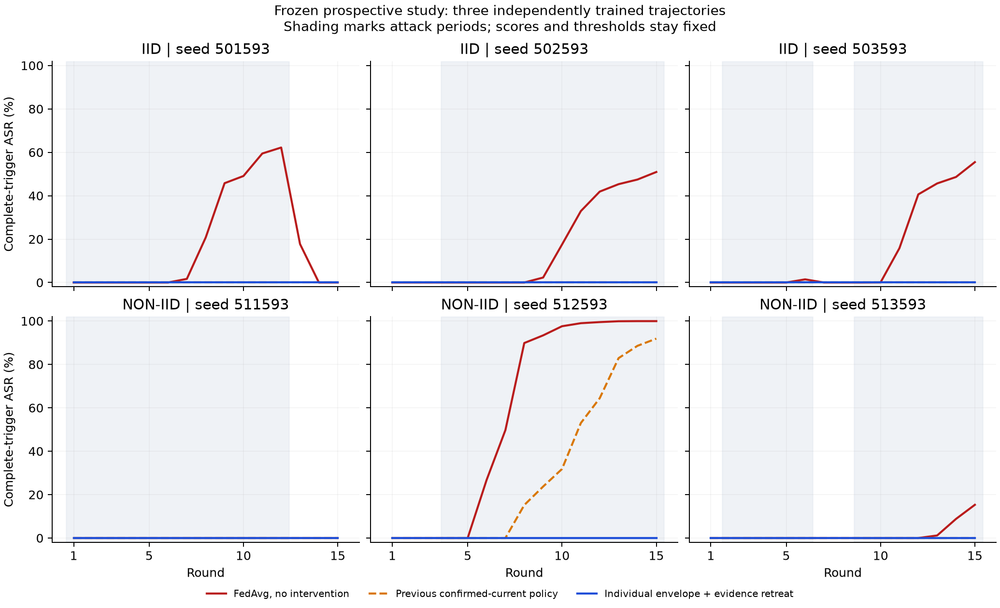
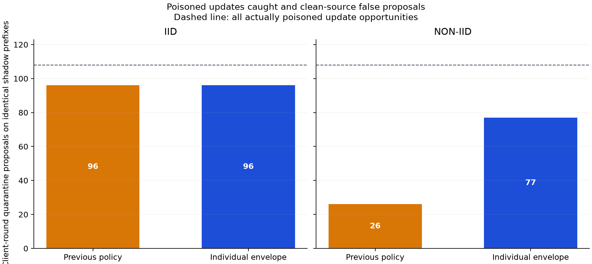

# Individual clean envelopes and current-evidence retreat

Date: 2026-11-03. Branch: `revision/derivation-protocol`.

## Prospective outcome

The new empirical policy individualizes the clean risk envelope for every client
and predictor view. It supplements the previous confirmed-current rule with a
channel that requires two consecutive high observations and releases when
current excess evidence falls below half its peak in that uninterrupted high
episode. The older predictor models remain unchanged. Geometry-only filtering
was investigated and rejected because it produces many false proposals.

The complete predeclared prospective criteria pass:

| Criterion | Result |
| --- | --- |
| active_envelope_final_macro_F1_within_0_02_of_prior | True |
| active_envelope_peak_ASR_not_worse_than_prior | True |
| no_active_quorum_failure | True |
| shadow_non_iid_recall_strictly_above_prior | True |
| zero_currently_clean_scheduled_attacker_envelope_proposals | True |
| zero_never_attacker_envelope_proposals | True |

The criteria count new-policy proposals on **all 36 trajectories**, including
proposals not applied on old-policy or no-intervention histories. Across this
whole set there are **0 never-attacker proposals** and
**0 currently-clean scheduled-attacker proposals**.
These are client-round counts, not distinct client identities. On the six
actually executed new-policy attacked histories it intercepts
**174/216 (80.56%)**
poisoned updates. The method is a cohort-bound empirical policy, not proof of
malicious intent or a universal false-positive guarantee.

## Development investigation and discarded alternatives

The 48 episodes from the preceding two policy studies are now declared
development data. Neither is relabeled as a fresh evaluation. The fixed first
comparison explored every matrix row/column and vector tensor, robust per-client
coordinate whitening, group-normalized residual risks and two-view corroboration
in the same group. All 483 public parameter groups are included; no attack feature
index or known malicious identity is supplied to the detector.

Geometry-only confirmation has 838 never-attacker proposals,
157 currently-clean scheduled-attacker proposals and
71 quorum failures on those old observations. It is unsuitable for
automatic quarantine and is not the deployed action channel in this experiment.

Per-client tensor envelopes instead improve sensitivity substantially, with one
remaining clean-source false proposal after cessation. Investigation showed an
approximately collapsed excess while the raw score was still slightly over its
individual envelope. A second explicit development hypothesis fixed a halving
rule before scoring it; there was no searched threshold grid. The selected union
catches 225 poisoned updates versus
166 for the preceding rule on the old shadow prefixes,
with zero never-attacker/currently-clean scheduled-attacker proposals on all 48
development cases. This is method selection evidence, not prospective validation.
All discarded results and both development protocols are preserved.

## Selected rule and formal boundaries

For client i and view v, the new envelope is the maximum risk among declared
clean null responses for that client/view, plus 0.05 raw log1p risk units.
Calibration includes ordinary clean trajectories and matched-state clean local
training at historically affected checkpoints. Normalizer/null source frames
are disjoint. The predictor references and cohort identities remain trusted
clean-phase assumptions. There is no original-row input to fitting or inference.

Let `e[i,t] = min_v(risk[i,v,t] - limit[i,v])`. During an uninterrupted supported
episode with `e > 0`, retain its peak `p`. A new channel regards evidence as
current and retained only when `e > 0 AND e >= 0.5*p`. Two consecutive retained
rounds authorize its quarantine proposal. Non-high or unsupported observations
reset both peak and confirmation. A collapsing signal stops this channel even
if its raw risk remains slightly over the envelope. The peak can suppress a
quarantine, but can never authorize one without positive current evidence.

The final proposal is the union of that confirmed channel and the previous
confirmed-current proposal. Either channel needs its own two-round confirmation;
one frame in each of two different channels is not sufficient. The previous
channel can continue a quarantine only with its own current strong evidence.
Cumulative evidence remains review-only. No permanent ban is introduced and all
15 clients continue submitting after every quarantine.

This yields a structural current-evidence bound: every quarantine requires a
confirmed channel with present evidence. A stored peak or CUSUM alone cannot
authorize action. Prefix-only input, trusted predecessor, exact-observation
binding, idempotent retry, mandatory-gate noncompensation and quorum failure
behavior are retained. Release is statistical release, not a benign label or an
override of mandatory rejection. Classification accuracy remains empirical.

The new `client_envelope_policy` composes the unchanged prior policy and exposes
an independent action chain. The record identifies each authorizing channel,
current minimum excess, episode peak, retreat and the prior-policy digest. Both
chains are independently checked against the same current observations. The
local analyst signature is not an independent witness, trusted time or TPM Quote.

## Frozen persistent-attack study

The selected method, source, fit inputs, worker, controller, model bindings and
acceptance criteria were fixed before any new campaign. There are **36 episodes
of 15 rounds**: IID seeds 501593–503593 and non-IID seeds 511593–513593;
clean/distributed modes; no intervention, active prior policy and active new
envelope policy. These are three independently trained histories, not merely
three sets of shadow labels on one frozen history.

All attacks include 12 attacking rounds. Schedules are 1–12, 4–15, and bursts
2–6/9–15. Changed attacker triplets are 02/06/13, 03/08/14 and 01/09/15;
roles modify features 13, 17 and 24. These generation/evaluation details are
withheld from the worker. The same committed Data24 snapshots, local Adam
protocol, seeds, row-count weights and complete participation are used in each
paired comparison. IID/non-IID retain separately fitted fixed-cohort references.
This adds stronger within-dataset tests, not an independent dataset result.

The envelope fit is repeated in a network-disabled read-only Docker worker using
only clean observable model arrays. Inference has only code, frozen models,
calibration and a one-request inbox. Raw rows, attack plans, seeds and future
frames are unavailable. The worker receives the public prior/envelope algorithm
selector, which is required to choose the active policy, but no attack mode or
schedule. The simulator/evaluator can access source rows and attack truth; those
capabilities are not attributed to the detector.

## Detection on identical no-intervention prefixes

State support and abstention are reported for every branch, including clean and
attacked episodes. Abstention is not counted as successful detection:

| Partition | Trajectory | Supported rounds | Unsupported rounds | Completed rounds |
| --- | --- | --- | --- | --- |
| iid | shadow-FedAvg | 90 | 0 | 90 |
| iid | active-prior | 90 | 0 | 90 |
| iid | active-envelope | 90 | 0 | 90 |
| non-iid | shadow-FedAvg | 89 | 1 | 90 |
| non-iid | active-prior | 90 | 0 | 90 |
| non-iid | active-envelope | 90 | 0 | 90 |

| Partition | Policy | Poisoned proposals / opportunities | Never-attacker proposals | Currently-clean scheduled proposals | Review client-rounds |
| --- | --- | --- | --- | --- | --- |
| iid | prior | 96/108 (88.89%) | 0 | 0 | 140 |
| iid | envelope | 96/108 (88.89%) | 0 | 0 | 140 |
| non-iid | prior | 26/108 (24.07%) | 0 | 0 | 152 |
| non-iid | envelope | 77/108 (71.30%) | 0 | 0 | 101 |

These no-intervention histories give a fair classification comparison with equal
observable prefixes. The aggregate non-IID recall improvement is a predeclared
criterion. Review is not counted as a successfully quarantined poisoned update.
Finite zero-error observations do not establish a population false-positive rate.

## Actually applied new-policy actions

| Partition | Seed | Poisoned updates quarantined | Never-attacker exclusions | Currently-clean scheduled exclusions | First actual-poison delays, attacker order |
| --- | --- | --- | --- | --- | --- |
| iid | 501593 | 33/36 (91.67%) | 0 | 0 | 1, 1, 1 |
| iid | 502593 | 33/36 (91.67%) | 0 | 0 | 1, 1, 1 |
| iid | 503593 | 30/36 (83.33%) | 0 | 0 | 1, 1, 1 |
| non-iid | 511593 | 24/36 (66.67%) | 0 | 0 | 9, 1, 1 |
| non-iid | 512593 | 24/36 (66.67%) | 0 | 0 | 1, 1, 1 |
| non-iid | 513593 | 30/36 (83.33%) | 0 | 0 | 1, 1, 1 |

`none` means that client has no actually poisoned update quarantined. There can
be missed early, weak or receding updates despite a later successful proposal.
All per-client timelines, currently-clean costs, releases and review counts are
retained in `prospective-evaluation.json`.

## Numerical comparison of independently trained histories

| Partition | Seed | FedAvg peak ASR | Prior peak ASR | New peak ASR | Prior / new final ASR | New minus prior final macro-F1 |
| --- | --- | --- | --- | --- | --- | --- |
| iid | 501593 | 62.20% | 0.00% | 0.00% | 0.00% / 0.00% | +0.0000 |
| iid | 502593 | 50.93% | 0.00% | 0.00% | 0.00% / 0.00% | +0.0000 |
| iid | 503593 | 55.47% | 0.00% | 0.00% | 0.00% / 0.00% | +0.0000 |
| non-iid | 511593 | 0.00% | 0.00% | 0.00% | 0.00% / 0.00% | -0.0007 |
| non-iid | 512593 | 99.94% | 91.87% | 0.00% | 91.87% / 0.00% | +0.0024 |
| non-iid | 513593 | 15.31% | 0.00% | 0.00% | 0.00% / 0.00% | -0.0003 |

There are 5/6 attacked no-intervention controls with nonzero complete-trigger
ASR during the trajectory. Zero-ASR controls can validate the action/source
classification behavior but cannot demonstrate neutralization of an otherwise
effective complete-trigger attack. Peak ASR, not only final ASR, matters. The
criterion compares the new active peak with the old active peak for each paired
seed; the clean utility criterion allows at most a 0.02 macro-F1 drop per pair.
Every-round clean metrics, full/component-trigger ASRs, conditional ASR and
untriggered target rates are retained. No final test set is used.

All clean active prior and envelope histories equal their no-intervention clean
history byte-for-byte: **True**.
For attacked cases, final model distances and validation prediction differences
against all-client clean references are also recorded. Changed participation
can explain part of that distance; it is not all automatically attributed to
residual poisoning. ASR zero alone does not prove clean-history recovery.
Previously affected checkpoints still require a separate, matched-participation
historical replay for remediation claims.

## Validation, integrity and scope

The complete suite passes **631 tests**, zero failures/errors/skips, with two
existing Typer warnings (121.90 seconds). Twenty-seven new tests cover
observable-only geometry, public group coverage, localized departures, clean
split separation, predictor binding, serialization, floating-point prefix
agreement, private/nonfinite input rejection, individual low-amplitude detection,
evidence collapse, episode peaks, reconfirmation, gates, quorum, retries,
strict decision-prefix invariance and mass/action separation. An initial
over-strict floating-point equality check and a syntax issue were corrected
before prospective freezing; initial test outputs are preserved.

The evaluator authenticates every episode, checks every source local model and
row-set commitment, reconstructs aggregates independently, and recomputes both
policies from logged observable risks. Verification counts are:
**8100 local updates**,
**540 aggregates** and
**1080 policy decisions**.
This step adds **8,100 local training calls and 540 actual FL rounds** if all
36 episodes finish; actual completed-round counts above are authoritative.
No development replay or reused clean observation is counted as new training.

The 112 prior package files, previous signed cases, Git index and 22 actual
thesis source files are preserved. Only the two new modules and their tests are
added. Repository explanations are English. No thesis edit, commit, push, fresh
TPM campaign or live production admission change is performed.

Passing the finite criteria, if achieved, supports this cohort-bound policy on
this protocol. It does not establish adaptive-attack resistance, clean drift or
unseen-cohort performance, automatic semantic malice, complete colluding-group
identification or safe universal exclusion. The professor-approved retrospective
scope and separation of provenance, influence and semantic review remain intact.

A separate input-level audit, `peak-suppression-audit.json`, exhibits a concrete
limitation of the retreat mechanism. A positive excess of 0.4 followed by
sustained excess 0.1 remains review-only while the old global channel stays
below its limit: the uninterrupted-episode peak has no timeout. Thus the policy
does not guarantee eventual quarantine of every persistent above-envelope
sequence. This is a synthetic observable-risk counterexample, not a demonstrated
realizable DBA model-update attack. It was recorded without changing the frozen
method or prospective criteria and must be addressed in any adaptive-robustness
claim. Passing the present benchmark does not remove that limitation.

Primary research context: [FLDetector](https://arxiv.org/abs/2207.09209) motivates
checking update consistency over time; this work uses empirical multi-epoch
optimizer-delta references, not its gradient/L-BFGS implementation.
[FoolsGold](https://www.usenix.org/conference/raid2020/presentation/fung) studies
sybil update diversity; the discarded geometry head here is not an implementation
or benchmark replication of that method. Neither paper certifies our new policy.

Protocols, all development alternatives, fit/inference inspections, full results,
source archive and a signed analyst completion accompany this report. Payloads
remain in `artifacts/revision-geometry-detector-v1`; the directory name also
preserves the discarded geometry investigation rather than erasing it.
