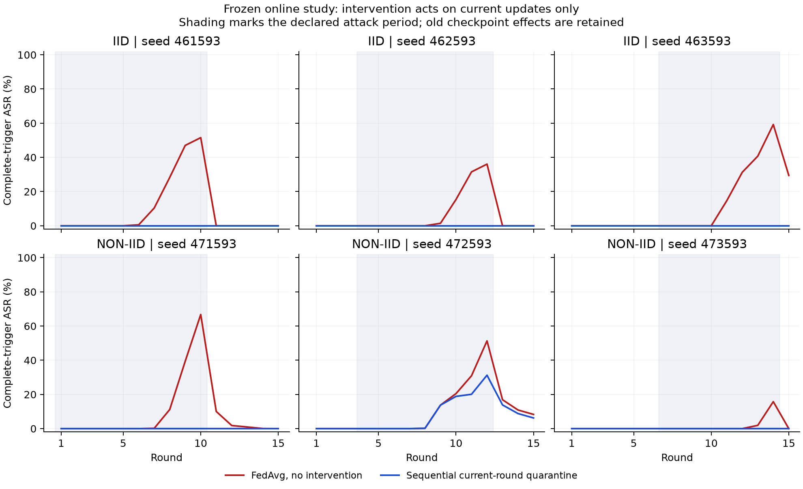
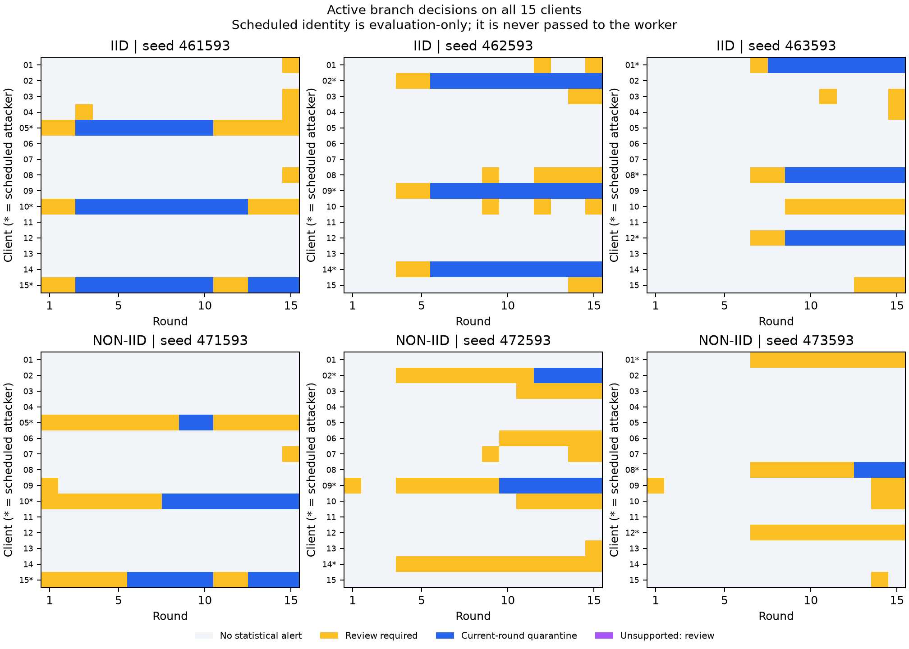

# Prefix-only, current-round decision policy

Date: 2026-11-03. Branch: `revision/derivation-protocol`.

## Result and scope

The new experimental `fl_forensics.sequential_decision` module separates review
from temporary current-round quarantine. It retains disagreements between the
existing state-conditioned and state-disabled views, accumulates evidence using
only observed prefixes, binds decisions to their exact observation and trusted
predecessor, and preserves mandatory-gate noncompensation. It does not ban clients
permanently or assign semantic malice.

The complete set of narrowly predeclared pilot criteria is **not satisfied**:
zero observed quarantines of never-attacking clients (False),
at least one actually poisoned update proposed for quarantine in each attacked episode
(True), and no active quorum failure
(True). The second criterion is intentionally
limited: it does not mean all attackers or all poisoned updates were intercepted.
These finite results do not qualify the policy for automatic live deployment.
In particular, the shadow branches produce three erroneous quarantine proposals
for never-attacking clients. Actual active branches exclude none of those clients.
The conservative overall check counts the erroneous proposals too. The first
evaluator restricted that check to active actions; `acceptance-scope-audit.json`
preserves and corrects that scope interpretation without changing any decisions,
measurements or thresholds. The original result is retained, not overwritten.

Across the six attacked active episodes, it quarantines
80/162 (49.38%)
actually poisoned update opportunities. It also excludes
32 contributions trained on original, clean local rows after attack cessation.
Those updates can still inherit an affected incoming checkpoint; source-data
cleanliness and model-state contamination remain distinct. Current-round action
does not repair earlier checkpoints. Read the numerical trajectories alongside
the action counts.

## Decision rule and boundaries

For client i and view v, positive standardized risk is
`z[i,v,t] = max(0, (risk[i,v,t] - median[i,v]) / scale[i,v])`.
The clean calibration fixes the median and MAD-based scale, with a scale floor
of 0.05. Cumulative evidence follows
`C[i,v,t] = max(0, C[i,v,t-1] + z[i,v,t] - 0.5)`.

Quarantine requires both view accumulators to exceed their fixed limits, positive
current increments in both views, and at least two consecutive supported positive
increments in both views. A single peak is insufficient. An alert in only one
view, including a disagreement masked by the earlier combined score, remains a
review item. Both views use the same source updates and are correlated; they are
not independent statistical confirmations. No-alert means no statistical alert,
not proof of benign intent.

Each action concerns one round. All 15 clients submit again in the next round,
including previously quarantined clients. A new low-risk update can be admitted;
no client-ban list is introduced. Original aggregation mass affects review
priority only, never the evidence votes or the mandatory gate.

A failed mandatory gate always sets that contribution's effective mass to zero.
The fixed-population statistical detector then abstains and requires review.
Unsupported incoming states reset cumulative evidence and cannot trigger a
statistical quarantine. A lost quorum stops the proposed aggregation instead of
re-admitting excluded contributions. The benchmark uses structurally valid,
gate-passing submissions; invalid production payload handling is not exercised
through this worker. These gate/quorum branches are covered by focused tests.

The API enforces monotonic rounds, the supplied trusted predecessor and an exact
observation SHA-256. An identical retry returns the stored decision without
counting evidence twice. A conflicting retry is rejected. Hash chaining requires
a trusted external head; it does not create an independent witness or a trusted
timestamp. This experimental adapter is not connected to live admission.

## Frozen calibration and reserved cases

The prior predictor models remain unchanged. Sequential calibration uses only
known-clean local-update responses: the earlier clean normalization split;
earlier ordinary clean trajectories and matched-state clean responses; and six
new clean 15-round campaigns. Matched-state responses use checkpoints from
earlier attacked trajectories but execute clean local training. They are now
explicitly development/null controls, not a reused held-out evaluation.

Normalization and cutoff source frames are disjoint. Cutoffs use the maximum
over clients and all prefixes plus a fixed margin of 1. Review uses the 99th
percentile plus 0.25. Short historical null histories are cycled from every
starting point to 15 rounds. These are dependent stress sequences, not new
independent campaigns or calibrated false-positive probabilities. Known-clean
state-support limits are fixed before reserved generation. IID and non-IID use
separate cohort-bound reference models; new populations require new validation.

The new reserved study has 24 episodes, each with 15 rounds: three seeds per
partition, clean/distributed modes, and shadow-FedAvg/active-sequential branches.
IID seeds are 461593, 462593, 463593; non-IID seeds are 471593, 472593, 473593.
Scheduled attacker triplets are 05/10/15, 02/09/14 and 01/08/12 respectively,
with attack periods 1–10, 4–12 and 7–14. Each role modifies a different feature
(13, 17 or 24). Training uses the committed Data24 snapshots, 15 clients, the
existing local Adam protocol and original row-count FedAvg weights. This is
additional replication within fixed partitions, not a new independent dataset.

The shadow branch records decisions without applying them. The active branch
applies only the current sequential quarantine. An instantaneous two-view rule
is recorded on the same prefixes as a comparator; it has no separately trained
active trajectory. Attack plans, seeds, branch labels and source rows remain
outside the detector container. It receives an opaque stream identifier, public
cohort, current model observations, masses, gates and predecessor.

The persistent Docker worker has no network, a read-only filesystem and only
code, reference models, calibration and a one-request inbox mounted. At a
decision it has no future-round files. The cutoff worker sees only observable
risk summaries. Simulator and evaluator have the original snapshots; this access
is not attributed to the detector. Runtime inspections and payload commitments
are preserved. There is no new TPM campaign or production rollout in this step.

## Current-round actions

| Partition | Seed | Attack rounds | Poisoned updates quarantined | Never-attacker quarantines | Clean-source updates excluded after cessation | First quarantine delays, attacker order |
| --- | --- | --- | --- | --- | --- | --- |
| iid | 461593 | 1–10 | 24/30 (80.00%) | 0 | 5 | 2, 2, 2 |
| iid | 462593 | 4–12 | 21/27 (77.78%) | 0 | 9 | 2, 2, 2 |
| iid | 463593 | 7–14 | 19/24 (79.17%) | 0 | 3 | 1, 2, 2 |
| non-iid | 471593 | 1–10 | 10/30 (33.33%) | 0 | 8 | 8, 7, 5 |
| non-iid | 472593 | 4–12 | 4/27 (14.81%) | 0 | 6 | 8, 6, none |
| non-iid | 473593 | 7–14 | 2/24 (8.33%) | 0 | 1 | none, 6, none |

Delays are measured in rounds from the first actually poisoned local update;
`none` means no quarantine, not successful admission review. After-cessation
exclusions are reported separately instead of being counted as true positives.
Review and quarantine are mutually exclusive action labels in each client-round.
Active branches generate 211 review client-rounds out of
2700 client-round observations; 46 occur in clean episodes.
Of the reviews, 106 concern never-attacking clients.
These burdens and the recurring exclusions after cessation prevent interpreting
zero never-attacker quarantines as zero operational cost.

The shadow-only comparison below uses identical observed prefixes for both
rules; it does not compare two active policies under equal resulting histories.

| Partition | Rule | Poisoned updates proposed for quarantine | Poisoned opportunities | Never-attacker proposals | After-cessation clean-source proposals |
| --- | --- | --- | --- | --- | --- |
| iid | instantaneous | 81 | 81 | 1 | 0 |
| iid | sequential | 64 | 81 | 3 | 22 |
| non-iid | instantaneous | 38 | 81 | 0 | 0 |
| non-iid | sequential | 16 | 81 | 0 | 19 |

No threshold is revised or selected after these results. Persistence is an
engineering guard against isolated peaks. On these common shadow prefixes the
instantaneous comparator catches more poisoned updates (119/162 versus 80/162),
has fewer never-attacker proposals (1 versus 3), and no after-cessation proposals
(versus 41). The sequential quarantine rule is therefore empirically inferior
on these measured criteria. It should not be promoted as an improved exclusion
detector. The instantaneous comparator is also not error-free and has no active
outcome validation here.

## Numerical outcome and remaining state effects

| Partition | Seed | Clean-reference final ASR | FedAvg final ASR | Active final ASR | FedAvg / active peak ASR | Active minus FedAvg final macro-F1 |
| --- | --- | --- | --- | --- | --- | --- |
| iid | 461593 | 0.00% | 0.00% | 0.00% | 51.54% / 0.00% | +0.0025 |
| iid | 462593 | 0.00% | 0.00% | 0.00% | 36.06% / 0.00% | -0.0110 |
| iid | 463593 | 0.00% | 29.44% | 0.00% | 59.23% / 0.00% | +0.0053 |
| non-iid | 471593 | 0.00% | 0.00% | 0.00% | 66.74% / 0.00% | -0.0017 |
| non-iid | 472593 | 0.00% | 8.30% | 6.23% | 51.32% / 31.24% | -0.0003 |
| non-iid | 473593 | 0.00% | 0.00% | 0.00% | 15.76% / 0.00% | -0.0007 |

ASR uses the full evaluation trigger and non-target validation denominator.
Every-round clean metrics, component-trigger ASRs, untriggered target rates and
reference-correct conditional ASRs are retained in `online-trajectories.json`.
Peak ASR matters because a final score after an attack stops can hide earlier
compromise. The same no-final-test-set validation split is used for all branches.

All six clean active/shadow pairs have identical complete checkpoint histories:
True.
For attacked cases, `online-evaluation.json` additionally records parameter L2
distance, checkpoint equality and validation prediction disagreements against
the same-seed, all-client clean reference. Distance alone cannot attribute a
residual wholly to poisoning because policy-induced participation also changes
the model. ASR zero alone is not a clean-history recovery claim. A matched
counterfactual replay remains the appropriate separate recovery analysis.

## Validation, limitations and relation to the thesis requirements

All **590 tests pass**, zero failures/errors/skips; two existing Typer deprecation
warnings remain (99.25 seconds). Twelve new focused tests cover review
disagreements, persistence, temporary release, idempotent retries, source binding,
prefix invariance, mass/priority separation, mandatory gates, unsupported states,
quorum failures, digest integrity and clean calibration separation.

Post-study verification authenticates the episode closures, checks all **5,400
evaluation local models** against their observable exports, verifies the row-set
commitments against the declared generation plans, independently reconstructs
**360 aggregates**, checks the model chain, and independently recomputes all
**360 prefix decisions** and exact aggregation weights. The complete step adds
**6,750 local training calls and 450 actual FL rounds**, including clean
calibration. These correlated client-round counts are not independent trials.

The policy needs trusted clean calibration, a fixed known cohort and a trusted
predecessor. It has not been validated against adaptive attackers, clean concept
drift, unseen cohorts or independent datasets. Reviews still need investigation;
the worker does not automatically resolve them. The study does not prove intent,
collusion, complete group membership or live safety. The professor-approved
retrospective scope—candidate groups compatible with coordinated behavior,
group/single counterfactuals, structural blast radius and separate numerical
effects—remains the appropriate thesis claim.

The existing provenance graph and historical replay are preserved. This step
adds a decision boundary and measures its costs; it does not replace the formal
model or silently rewrite historical decisions. The full previous package is
unchanged except for the added module. Earlier signed artifacts, the Git index
and the 22 actual thesis source files are preserved. Repository explanations
are English; no thesis edit, commit, push or live deployment is performed.

For the cumulative-chart background, see the primary
[NIST CUSUM handbook](https://www.itl.nist.gov/div898/handbook/pmc/section3/pmc323.htm).
Its distributional/independence assumptions and run-length guarantees are not
transferred to these correlated FL observations. Our limits are empirical.

Evidence includes the pre-training protocol, frozen policy/model bindings,
execution map, runtime inspections, source archive, signed analyst completion,
test XML and complete evaluation. Numerical payloads remain under
`artifacts/revision-sequential-round-policy-v1`. The analyst's software signature
authenticates this local result; it is not an independent receipt witness or
TPM-backed client attestation.
