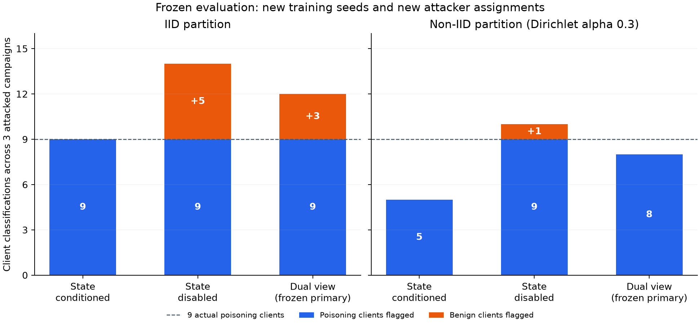

# State-conditioned update audit: implementation and frozen evaluation

Date: 2026-11-03. Branch: `revision/derivation-protocol`.
Thesis sources are unchanged in this step. Documentation is maintained in English.

## Result and decision

The incoming global checkpoint is now an explicit input to an empirical clean
client-update predictor. Fitting, calibration and inference ran inside a read-only,
network-disabled Docker environment with no client datasets or attack labels
mounted. The new evaluation changes both training seeds and attacker identities,
and includes IID and non-IID partitions.

Conditioning on the checkpoint removes benign false candidates in the tested IID
cases, including clients responding to checkpoints from attacked trajectories.
However, no predeclared method is uniformly best across the two partitions. The
frozen primary dual-view method recovers 17 of 18 poisoning-client occurrences in
the attacked evaluation campaigns, with three benign false candidates. It is not
promoted to automatic exclusion or complete colluding-group identification.

Full retraining of its selected sets matches a clean reference with identical
participation in five of six cases. The missed non-IID contribution leaves a
12.7874% ASR after full replay. Exact reference equivalence and candidate accuracy
are separate properties: removing benign false candidates can still produce a
reference-equivalent model for the unnecessarily reduced population.

## 1. Why the previous comparison needed a structural extension

A benign client's update is a response to its incoming global model. A poisoned
checkpoint can therefore change benign updates and their similarities. Comparing
them only against a clean trajectory risks confusing inherited exposure with a
local departure from expected training behavior.

The new predictor learns the map from a server-visible checkpoint W to each
client's multi-epoch model delta D. It uses a client/layer scalar clean secant
response plus a low-rank ridge correction, regularized at 0.1. This operates on
actual optimizer outputs, not gradients. A robust common residual is removed
before measuring each client's layer-normalized prediction error.

Checking predicted versus observed historical updates is also central to
[FLDetector (Zhang et al., KDD 2022)](https://arxiv.org/pdf/2207.09209).
The present ridge/secant predictor is a distinct empirical adaptation for the
existing ten-epoch Adam updates. It is not a reproduction of FLDetector's
L-BFGS/gradient method or a transfer of its theoretical guarantees.

The implementation keeps three predeclared views:

- **State conditioned:** the predictor uses the incoming checkpoint.
- **State disabled:** a clean client-specific update reference without that
  conditioning; all other data and scoring controls are retained.
- **Dual view, frozen primary:** the geometric mean of the nonnegative
  standardized scores of both views, with its own clean-only threshold.

The dual view was chosen after inspecting already seen development cases. On
those cases it recovered the third attacker without the state-disabled view's
benign candidates. That is a development result, not held-out evidence. The new
evaluation below was then frozen before generating its cases.

## 2. Observable-only API and calibration

Implementation is in:

- `src/fl_forensics/state_conditioned_audit.py`
- `src/fl_forensics/state_conditioned_fusion.py`
- `tests/test_state_conditioned_audit.py`

Inputs contain global checkpoints, client deltas, client IDs, tensor shapes and a
public cohort binding. Raw rows and attack-label fields are rejected. The API
checks finite tensors, schemas, complete calibrated horizons, model/calibration
identities and frame-level separation between fitting, calibration and evaluation.
Unseen cohort bindings require another clean reference. Insufficient calibrated
state support produces an abstention rather than an accusation.

The campaign score is the 0.8 quantile of supported frame risks. Clean client
centers/scales and a family maximum threshold are calibrated on separate clean
cases, with a fixed one-scale margin. Each view's threshold and the joint threshold
were fixed before held-out generation. All 18 evaluation inputs retained ten
supported frames; no difficult case was removed by an abstention.

The reference phase includes clean responses to controlled checkpoint
perturbations. Perturbation scales come only from clean checkpoint changes, with
fixed norm multipliers 0.5, 1, 2 and 4. This is an additional clean calibration cost
and assumption. It does not require the detector to obtain private client rows:
the fitting input consists of the resulting server-visible models.

## 3. Frozen design and evidence isolation

The IID reference reuses clean development trajectories; the non-IID reference is
fitted and calibrated separately on clean campaigns. Each cohort has 30 normal
fitting frames plus 32 clean stress contexts, and 30 normal calibration frames
plus 20 separate stress contexts. The calibration cases include three actual
trajectories and two ten-context banks; these banks are not independent FL runs.

New primary evaluation pairs are:

| Partition | Training seeds | Experimental attacker sets |
|---|---|---|
| IID | 431593, 432593, 433593 | 02/07/12, 03/08/13, 04/09/14 |
| Non-IID | 441593, 442593, 443593 | 02/07/12, 03/08/13, 04/09/14 |

Each seed has a clean and an attacked ten-round campaign. The non-IID partition
uses Dirichlet alpha 0.3 and has 52–1,688 training rows per client. Both partitions
use 7,096 distinct training windows, disjoint from the existing 3,223 validation
examples. No final-test evaluation is used. Client datasets and trigger features
remain known experimental material; this is not an independent-dataset evaluation,
unseen-trigger test or transfer of one IID predictor to an uncalibrated cohort.

Models were frozen inside Docker before generating these twelve campaigns. Six
additional matched-state controls were specified before held-out inference. In
each, all clients execute unmodified training from the corresponding attacked
trajectory's actual incoming checkpoints. Outputs do not drive future checkpoints:
these are conditional response banks, not repaired autoregressive trajectories.

All eighteen observation sets were assigned neutral aliases before inference.
The container mounted only those observations, the frozen models and two analysis
modules. Original data paths, private generation protocols and attack identities
were unavailable. It also checked this negative capability at runtime. Selections
were closed before the evaluator accessed the identity map or ASR outcomes.

Docker fixes the analysis runtime and file-access boundary; this is software
analyst evidence, not a fresh TPM-attested client campaign. Runtime inspections,
model closures, source hashes and blinded input/selection bindings are retained.

## 4. New evaluation results

Each attacked cohort contains nine actual poisoning-client occurrences across
three cases. Every declared attacker changed its committed executed training
rows. The table includes all cases, including a non-IID attack with ASR zero.

| Method | IID true / missed / false clients | Non-IID true / missed / false clients | Exact attacked sets recovered |
|---|---|---|---|
| State conditioned | 9 / 0 / 0 | 5 / 4 / 0 | 3 of 6 |
| State disabled | 9 / 0 / 5 | 9 / 0 / 1 | 2 of 6 |
| Dual view, frozen primary | 9 / 0 / 3 | 8 / 1 / 0 | 3 of 6 |

All methods return no candidates on the six ordinary clean evaluation campaigns.
On the six matched-state all-benign response banks:

| Method | Benign client candidates | Banks with an alarm |
|---|---:|---:|
| State conditioned | 0 | 0 of 6 |
| State disabled | 3 | 3 of 6 |
| Dual view | 1 | 1 of 6 |

This provides a direct experimental reason to retain checkpoint conditioning. It
also shows that the development improvement of fusion does not generalize
uniformly. Choosing the conditioned method only for IID after viewing these
outcomes would be a new post-hoc policy requiring another evaluation; this report
does not present that combination as a validated winner.

The primary method has 17 true, three false and one missed poisoning-client
occurrence: precision 85% and recall 94.44% on the attacked cases. These are
descriptive results on six campaigns, not general deployment guarantees. Paired
response banks share source trajectories and cannot be counted as independent
extra trials when estimating uncertainty.

## 5. Direct effects and full selected-history replay

After closing classification results, a secondary protocol evaluated every method's
complete flagged set, each member individually and up to twenty benign
size-matched controls. No candidate was added or pruned using identity truth.
These frozen round-10 reaggregations are direct conditional effects, not repaired
later training. Correct identification of all three clients in non-IID seed
441593 still leaves ASR 15.1430% when only the final round is reaggregated.

The exact primary selections were then replayed from before the attack. At every
round the remaining clients trained again from the branch's actual global model.
Any missed attacker retained its original scripted poisoning behavior. An
independent clean reference used the same remaining clients, seeds, optimizer
reset policy and initial checkpoint.

| Partition / seed | False selected clients | Missed clients | Full-history ASR | Equal to matched clean history? |
|---|---:|---:|---:|---|
| IID 431593 | 0 | 0 | 0% | Yes |
| IID 432593 | 1 | 0 | 0% | Yes |
| IID 433593 | 2 | 0 | 0% | Yes |
| Non-IID 441593 | 0 | 0 | 0% | Yes |
| Non-IID 442593 | 0 | 0 | 0% | Yes |
| Non-IID 443593 | 0 | 1 | 12.7874% | No |

The no-intervention control reproduces all 150 local models and ten checkpoints
of non-IID seed 441593 byte-for-byte. Replays and matched references add 1,550
local training calls and 130 aggregation rounds. Full-history equality concerns
the declared remaining population: it does not justify excluding benign clients
or prove recovery of the hypothetical clean model with all participants retained.

The failed case is informative. Client14 has 1,688 rows, or 23.7880% of the
original aggregation weight. Its conditioned score is 6.1616 against threshold
8.3269, its state-disabled score 6.4280 against 5.9858, and its dual-view score
6.2934 against 7.0440. A single-view alert was therefore present but not retained
by the frozen primary combination. Its ten-round exclusion was not silently
added to make the replay succeed.

## 6. Operational conclusion

Keep the calibrated views and their disagreements available to the investigator.
In particular, an unselected single-view alert on a high-weight contribution is
an unresolved review item; it must not disappear behind a combined score or ASR
zero. Weight measures numerical influence, not malicious intent. Candidate sets,
attributed semantic review, graph exposure and clean-reference verification remain
separate evidence channels.

The new predictor is useful for retrospective audit and avoids several inherited-
state false candidates, but these results do not qualify it for automatic client
exclusion. The next method change should target the measured high-impact miss and
cross-view disagreement under non-IID data, with new cases reserved before any
threshold revision. Merely lowering the threshold to capture client14 in this
already evaluated case would not be a valid new result.

This completes the frozen comparison and causal replay study. It does not complete
general update-only identification of colluding clients, establish malicious
intent or replace the separately validated privileged audit with original data.

## 7. Verification and evidence

The complete suite passes **578 tests**, zero failures/errors/skips and two existing
Typer warnings (192.68 seconds). Seventeen new tests check state-response prediction,
controlled local deviations, unsupported-state abstention, complete horizons,
frame-level separation, view roles, cohort changes, serialization, tampered
calibration and rejection of raw-row/label inputs.

The step performs **6,710 new local training calls**: 780 development stress calls,
1,680 non-IID clean fitting/calibration calls, 1,800 held-out campaign calls,
900 matched-state clean responses and 1,550 selected-history/control replay calls.
There are 310 new autoregressive aggregation rounds and 164 conditional clean
contexts; conditional contexts are not relabeled as new FL trajectories. Reused
IID reference trajectories and direct reaggregations are not counted as new
training. The evaluator independently reconstructs 120 held-out aggregates and
checks all 1,800 source updates against their exported observations.

Artifacts beside this report include the frozen protocol, model and selection
closures, runtime inspections, complete evaluation and ablation tables, selected
direct effects, full-history comparisons, source archive, integrity checks and
test XML. Numerical payloads remain at the repository paths recorded in the signed
completion manifest. Earlier signed cases, the actual thesis sources and Git
index are preserved. No commit, push, thesis edit or automatic live policy change
is performed in this step.
