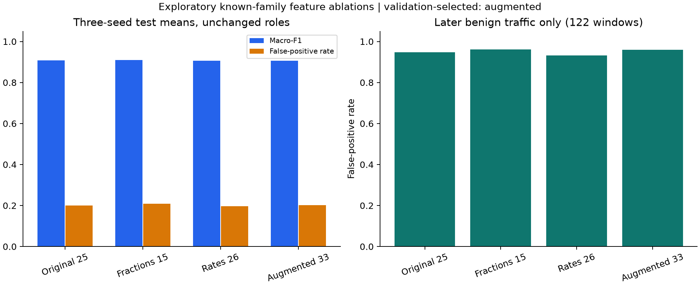

# ToN-IoT benign robustness: same-role feature and threshold controls

Completed on **9 November 2026**. The validation-selected representation is
**augmented**, with three-seed primary-view mean test macro-F1
**0.9066** and benign false-positive rate
**20.24%**. It does not jointly improve test macro-F1 and benign false positives relative to the parent.
The assessment preserves every declared configuration and all negative results.
It neither replaces the original unseen-MITM chronological test nor changes
the framework's default classifier or admission policy.

## Why overall F1 was insufficient

The [parent known-family benchmark](../revision-ton-iot-f1-assessment-v1/README.md)
reaches 0.9087 mean macro-F1 with 20.07% benign false positives, using
within-family time blocks and globally interleaved dates. A subsequent audit
finds that all 1,722 benign training windows come from 2-3 April 2019. Benign
validation contains 559 windows from 3 April and six from 4 April. Of the 578
benign test windows, 456 come from 4 April, while 122 come from 24-29 April.

The parent makes zero or one false alert among the 456 early benign windows,
but 110-119 false alerts among the 122 later windows across seeds. The 85 benign
windows from 28 April incur 82-84 false alerts. Capture dates are absent from
predictor inputs, but traffic volumes and other characteristics may still
encode capture-schedule differences. The diagnosis reveals a major calendar
confound in the available benign support and prevents interpreting overall F1
as evidence of reliable benign generalization. It does not establish that
volume is the sole cause. The source attack-family grouping describes the
dominant type of each attacked minute and is not a minority-type recall metric.

See [per-day parent evidence](parent-benign-period-diagnosis.json). The earlier
publication remains unchanged and this report adds the more specific limitation.

## Declared interventions

The first control centers the interval between the highest negative and lowest
positive validation score around the parent selected threshold. This preserves
every validation decision and tests whether a more stable position in the same
decision gap helps on test. It uses no new model fitting or test-based threshold
selection. The original threshold and fixed 0.5 are retained as controls. Across
all six parent view/seed combinations, the primary centered threshold produces
the same test confusion matrices as the original threshold. The threshold
position alone therefore does not resolve the observed failure.

The second control keeps exactly the same training, validation and test windows
and fits three explicit representations derived from the original aggregates:

| Representation | Predictor inputs |
| --- | --- |
| original25 | The parent 25 aggregates, with log transforms of the ten heavy-tailed fields |
| fractions | The 15 original protocol, service and connection-state fractions |
| rates | The 15 fractions, three log duration summaries and eight log uniqueness/intensity ratios, totaling 26 fields |
| augmented | The original 25 fields plus eight log ratios, totaling 33 fields |

The ratios comprise destinations and ports per connection, bytes and packets per
connection in both directions, and bytes per packet in both directions. Packet
denominators use a floor of one to keep zero-packet aggregates finite; these
ratios remain released-field summaries rather than reconstructed packet evidence.
Source IPs, dates, labels and attack names are absent from predictor inputs.
Uniformly scaling connection counts, unique counts, byte totals and packet
totals leaves the rate representation unchanged when the denominator floors
are inactive and duration/fraction fields are fixed. This is a specific
invariance, not general immunity to traffic distribution shift.

Standardization is fitted only on each training role. The study uses the same
15 numerical IID client allocations, three seeds, 30 FedAvg rounds, binary
loss weighting, 128/64/32 MLP, Adam learning rate 0.001, two local epochs and
batch size 128 as the parent. Eighteen new federated runs cover all three
representations and two source views. Twelve centralized Extra Trees and
histogram-boosting references retain their separate scope.

Every round selects a validation threshold maximizing macro-F1 subject to at
least 0.8 recall for each represented attack family, then centers its unchanged
validation gap. Checkpoints maximize validation macro-F1 with earlier ties.
The final federated representation maximizes mean occurrence-view validation
macro-F1 across seeds, including original25 as a candidate, with original25
preferred on exact ties. All choices close before any new-model test scoring.
The previously examined test remains an exploratory reused assessment, with
no fresh blind, globally chronological or host-independent claim.

## Complete primary-view comparison

Means below use all three seeds and the same test population. Parent and new
configurations retain their declared validation-selected checkpoints and rules.
The table is not a menu for choosing a default from test results.

| Representation | Validation macro-F1 | Test macro-F1 | Benign F1 | Attack F1 | Benign FPR | Attack recall |
| --- | --- | --- | --- | --- | --- | --- |
| original25 | 0.999047 | 0.9087 | 0.8778 | 0.9396 | 20.07% | 98.75% |
| fractions | 0.994527 | 0.9103 | 0.8791 | 0.9414 | 20.93% | 99.54% |
| rates | 0.997854 | 0.9058 | 0.8744 | 0.9372 | 19.67% | 98.06% |
| augmented | 0.999285 | 0.9066 | 0.8750 | 0.9382 | 20.24% | 98.55% |

Mean benign false-positive rates by capture period expose whether the pooled
score conceals later benign failures. These two periods are diagnostic strata,
not additional calibration populations.

| Representation | Early benign, 456 windows | Later benign, 122 windows |
| --- | --- | --- |
| original25 | 0.07% | 94.81% |
| fractions | 0.80% | 96.17% |
| rates | 0.00% | 93.17% |
| augmented | 0.00% | 95.90% |



All seeds, source views, family recalls, selected rounds and centralized results
are available in [the complete results](feature-study/results.json). The
[selection closure](feature-study/closure-before-test.json) records the exact
validation means. Small differences in near-perfect validation scores must not
be presented as reliable evidence of future performance. Any representation
with an attractive test result but weaker validation selection remains an
exploratory finding and is not silently promoted.

## Verification and storage

Fifty-nine focused tests and the library lint checks pass. Verification refits
all training-only scalers, compares the installed feature rules with the exact
executed snapshots, recomputes the 18 selected federated validation/test score
sets and freshly refits all 12 centralized references. All 30 new validation
and test metric sets and every margin-rule result are recomputed. A fresh
30-round replay of `occurrence-augmented-s341593` reruns 450 local updates and matches
every global tensor digest; local-update digest comparison is not claimed.
See [verification](verification.json) and [summary](summary.json).

Only each new run's selected global tensors are saved, with digests and
validation records for every round. This keeps retained model storage small.
Raw CSVs, existing checkpoint files, sealed parent publications and the
manuscript remain unchanged. Global selected tensors remain in the execution
workspace and are indexed in `execution-artifacts.json`, without duplication
in this publication. Sources contain both executed snapshots and the formatted
library/test files. These controls are honest-client numerical classification,
with no new TPM, Byzantine or witness-independence claim.

```bash
make test-ton-iot
make evidence-check STUDY=results/revision-ton-iot-benign-robustness-v1
```

The executed controllers have explicit study-specific sibling directory
bindings. Reproduction requires the retained parent roles, source windows and
checkpoint inputs. The standard test target includes the new margin and
representation tests and does not start a training campaign. Subsequent work
should address representative benign support under a separately frozen
assessment and evaluate any change in window granularity as a distinct
representation protocol. The existing test is not recycled as training while
retaining its performance claim.
