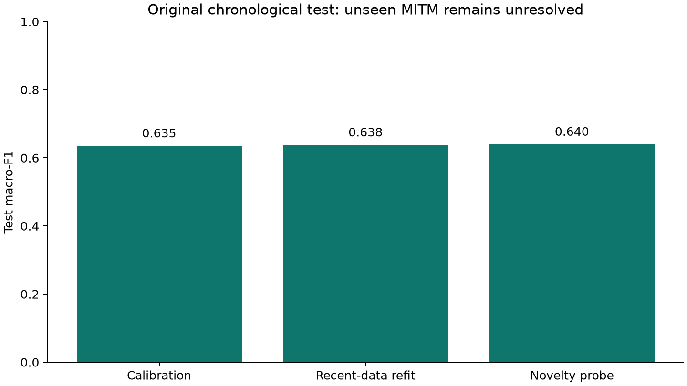
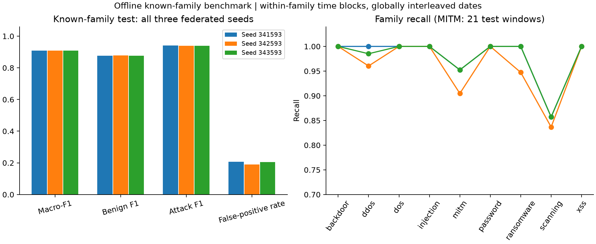

# ToN-IoT F1 assessment and separate known-family diagnostic

Completed on **9 November 2026**. A validation-selected federated classifier
achieves **0.9087 mean test macro-F1**, **0.8778 benign F1** and **0.9396 attack
F1** across three seeds in a separate offline benchmark with training support
for all nine attack families. Its **20.07% mean benign false-positive rate**
prevents an operational-readiness claim. The original chronological assessment
with previously unseen MITM remains unsuccessful and is preserved separately.

## Questions and interpretation

The initial independent-dataset programme established that unchanged source
transfer fails, then retrained binary classifiers using the existing 25 window
features. The [connection-end correction](../revision-ton-iot-flow-end-v2/README.md)
retains 6,061 training, 1,080 validation and 718 chronological test windows.
Only 30 test windows are benign, and the MITM family is absent from both fitting
and validation. This publication first asks whether calibration, regularization,
recent labeled data or benign novelty can improve that declared assessment.
Those attempts fail to deliver useful F1 for both classes.

A subsequent, separately declared question asks whether the representation can
classify traffic when every family has training support. Its role assignments,
population, preprocessing fit and threshold rule differ from the chronological
assessment. The positive result answers this second question and does not
repair the original result. Different test populations must not be presented as
a paired before/after performance improvement. Both assessments reuse an
already examined laboratory release and neither is claimed as a new blind test.

## Original chronological assessment: negative controls

| Stage | Declared intervention | Outcome |
| --- | --- | --- |
| Fixed F1 study | 48 configurations: 18 existing checkpoints, 12 regularized federated runs, 16 centralized references and two source-score controls; validation-only macro-F1 thresholds | No configuration meets macro-F1 >= 0.85 with both class F1 >= 0.80 |
| Final pre-test refit | 16 configurations; retire corrected validation into training, use a fixed nine-round budget, compare uniform and 48-hour recency weighting | Primary recency-weighted federated mean macro-F1 about 0.638; no useful recovery |
| Benign novelty probe | 36 classifier/anomaly combinations, full features or fractions, k-nearest neighbors, isolation forest or one-class SVM; thresholds calibrated on benign validation only | The validation-selected hybrid remains weak on the original test |

All configuration-level results are retained in `study/`, `final-refit/` and
`novelty-probe/`. The main fixed study chooses a family using mean validation
macro-F1 across the three primary-view seeds, then evaluates every configuration.
The refit retires validation into training and claims no independent post-refit
validation. Its budget is the median selected round of the previously selected
family. Transferred thresholds are diagnostic, and the primary refit uses 0.5.
The novelty stage selects its family using validation and retains every probe.
These are sequential exploratory studies following inspection of earlier
results; fitting isolation does not make their shared test newly blind.

The declared primary refit at seed 341593 misses 76 attack windows, all belonging
to MITM, while recognizing all 586 backdoor windows. The original test contains
102 MITM windows. The median attack-row fraction is about 9.64% in missed attack
windows and 96% in detected attack windows. The predictor aggregates a whole
minute, labels a window as attacked when any source row is attacked and does
not receive the source attack name. These observations identify novel-family
support and dilution as plausible limitations without isolating either as the
sole cause. See [error diagnosis](chronological-error-diagnosis.json).



## Separate known-family blocked benchmark

Windows are grouped by their dominant source attack type, with a separate
benign group, then ordered by time within each group. The first 60% form the
training candidate block, the next 20% validation and the last 20% test. Boundary
windows are excluded when their conservative observation-end bound does not
precede the next block by five minutes. This yields **4,647 training, 1,482
validation and 1,592 test windows**, with 213 purged windows. The test contains
578 benign and 1,014 attacked windows, including 21 MITM windows.

Whole window identities are disjoint, all families have support in every role
and no exact 25-feature test vector occurs in training or validation in either
source view. The dates are globally interleaved across families and the same
laboratory hosts remain involved. Consequently, this is an offline known-family
diagnostic with within-family chronological blocks. It establishes neither
global future-time generalization nor host independence. The five-minute bound
is a declared diagnostic boundary and differs from the original one-hour purge.

The model receives the existing 25 numeric aggregates, transformed using log1p
and a standard scaler fitted on the new training role only. Dates, IP addresses,
source attack types and identifiers are absent from its predictor inputs. Source
types are used for role allocation, optional training weights, IID client
allocation and stratified evaluation. The latter uses the dominant window type
and does not provide a separate recall estimate for every minority type within
a mixed window. This is binary classification, not nine-class attribution.

Fifteen numerical IID clients train a 128/64/32 binary MLP for 30 FedAvg rounds,
with Adam at 0.001, two local epochs and batch size 128. Binary-balanced and
family-balanced loss weights are compared across three seeds and two source
views. The family-balanced regime allocates half the training weight to benign
windows and divides the other half equally among attack families. Extra Trees
and histogram gradient boosting provide eight centralized references. All
20 configurations and all global checkpoints are retained in the execution
workspace, without a new raw-data extraction or Docker campaign.

For each round, the validation threshold maximizes macro-F1 subject to recall
of at least 0.8 for every represented attack family. The selected checkpoint
maximizes that validation objective, with earlier rounds preferred on ties.
The federated weighting regime is selected from mean validation performance
across seeds in the occurrence view, and centralized references are selected
separately. Choices are recorded in [the closure](known-family/closure-before-test.json)
before this benchmark's test scoring. Local closure files bind choices and
inputs; they are not independent timestamp attestations.

The selected federated regime is **binary-balanced**. Across three seeds, its
test macro-F1 ranges from **0.9083 to 0.9090**, with mean accuracy **91.92%**,
attack recall **98.75%**, benign F1 **0.8778**, attack F1 **0.9396** and false-positive
rate **20.07%**. MITM recall is 19/21 or 20/21, and the lowest family recall ranges
from 83.67% to 85.71%. These are small family samples and descriptive estimates.
The exact-projection sensitivity view produces similar macro-F1 near 0.908.
The selected centralized Extra Trees reference achieves **0.9066 macro-F1**;
this small difference does not establish federated statistical superiority.



Validation macro-F1 is approximately 0.999 while test macro-F1 is approximately
0.909. The residual false-positive rate demonstrates that strong validation
separation does not eliminate benign distribution shift. This result supports
target-domain learnability with representative labeled families, while broad
deployment reliability and unseen-family recognition remain open.

## Validation, retained artifacts and reproduction

Forty-nine focused tests and lint checks pass. The audit checks 360 known-family
global checkpoints and 468 additional calibration/refit checkpoints, recomputes
all 12 selected federated validation/test score sets and all 20 known-family
test metric sets, refits all eight known-family centralized references and
reproduces their scores exactly. One fresh federated replay reruns 450 local
updates and matches all 30 global tensor digests. Local update digests were
not retained for this new study, so no local-digest comparison is claimed.
The 48 calibration thresholds and test metric sets and 16 primary refit metric
sets are independently recomputed. See [verification](verification.json) and
[additional audit](additional-audit.json).

The publication retains protocols, fitting closures, results, score arrays,
histories, executed source snapshots and an execution-workspace checksum index.
Global tensor files remain in the original workspace and are not duplicated in
this publication. `execution-artifacts.json` identifies those files and hashes.
All raw CSVs, parent evidence and the manuscript remain unchanged.

```bash
make test-ton-iot
make evidence-check STUDY=results/revision-ton-iot-f1-assessment-v1
```

The reusable fixed F1 driver is `scripts/run_ton_iot_f1_study.py`; invoke
`--help` for explicit workspace, parent and transfer inputs. It refuses an
existing workspace and requires at least six GiB free before fitting.
`make ton-iot-f1-study` supplies guarded entry variables. Later diagnostic
controllers in `sources/` preserve exactly executed code with study-specific
sibling-directory bindings, rather than promising a portable deployment API.
Reproduction requires retained parent prepared inputs and source window
artifacts. These source bindings are recorded in the protocols and artifact
index. Saved metric arrays allow numerical review without retraining.

The study concerns honest-client numerical traffic classification. It does not
evaluate TPM attestation, Byzantine admission, DBA containment, formal-model
completeness or independently administered witness deployment.
