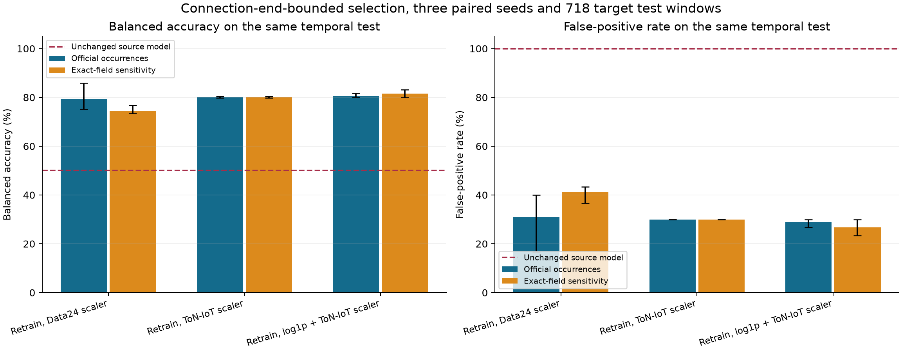
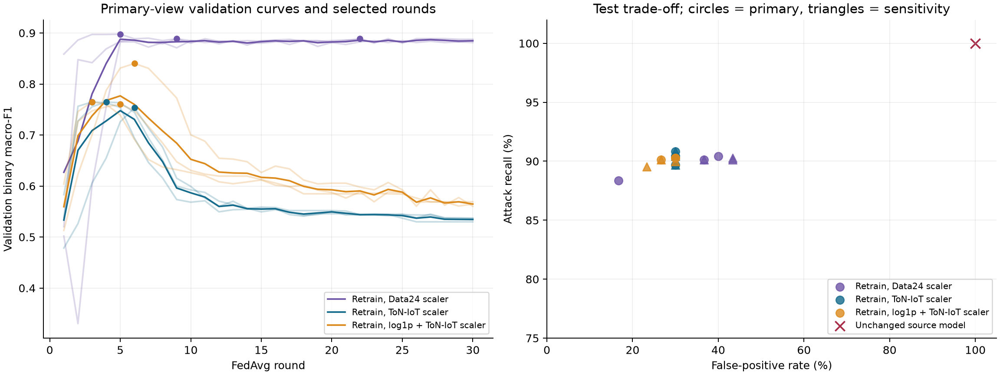

# ToN-IoT target diagnosis with connection-end-bounded selection

This is the current target-domain result. It corrects the temporal selection
boundary of the [initial target study](../revision-ton-iot-retraining-v1/README.md)
and retains that publication, its models and its reported metrics unchanged.
The correction removes 15 potentially late-observed validation windows and
changes five checkpoint selections in the source-scaler comparison. The primary
target-standard result remains **80.16% mean balanced accuracy**, **90.31% mean
attack recall** and **9/30 false positives for every seed** on the same temporal
test. It provides partial recovery without an operational-readiness guarantee.

## Why the temporal check was extended

Zeek connection timestamps refer to connection starts while duration and byte
measurements describe the observed connection. A minute can therefore start
before a split boundary and contain a connection lasting beyond that boundary.
The first study purged an hour based on window timestamps. A subsequent audit
found no possible training-to-validation crossings, but 14 validation windows
could extend into the test period and 15 beyond the pre-test embargo deadline.
The original study is historical evidence of its declared window-time rule and
is superseded for current checkpoint selection by this stronger bound.

The corrected selection retains a window only when
`window_end_epoch + duration_max_seconds + 1 <= next_split_start - 3600`.
The full minute allows the latest possible connection start and one second is
a conservative rounding guard. This bounds observations under the released
timestamp/duration semantics; it does not reconstruct packet-arrival or log-write
times and is not a trusted-clock attestation.

All 6,061 training windows satisfy the training observation deadline. Consequently,
training inputs, training-only scalers, class weights, IID partitions, seeds and
all 540 global checkpoint tensors are unchanged. The training schedule always
executes all 30 rounds and does not use validation to change optimization, so
the existing checkpoints can be reused for a corrected selection without new
gradient updates. The initial validation has 1,095 windows, and excluding the
15 long-connection windows leaves **1,080**, comprising 85 benign and 995 attack
windows. The test remains **718 windows**, with 30 benign and 688 attack windows.

The v2 protocol is recorded before recomputing validation scores. All 540
corrected validation macro-F1 scores are computed and the earliest maximizing
round is selected, then all 18 selections close before reevaluating their test
predictions. Test outcomes were already known from the initial study, so this
remains an exploratory correction, not a newly blind target test. The same three
scaling conditions, three seeds and two source-count views are retained.

## Corrected quantitative comparison

All entries are three-seed means on the same 718 test windows. The predeclared
primary condition remains target-standard scaling on official occurrences.

| Source-count view | Preprocessing for retraining | Balanced accuracy | Attack recall | False-positive rate | Binary macro-F1 | AUROC |
| --- | --- | ---: | ---: | ---: | ---: | ---: |
| occurrence | source-standard | 79.26% | 89.63% | 31.11% | 63.78% | 0.7971 |
| occurrence | target-standard | 80.16% | 90.31% | 30.00% | 64.99% | 0.8168 |
| occurrence | target-log1p | 80.66% | 90.21% | 28.89% | 65.09% | 0.9059 |
| exact-projection | source-standard | 74.53% | 90.16% | 41.11% | 62.28% | 0.8187 |
| exact-projection | target-standard | 80.16% | 90.31% | 30.00% | 64.99% | 0.8171 |
| exact-projection | target-log1p | 81.60% | 89.87% | 26.67% | 65.12% | 0.9101 |

The unchanged six-class Data24 model, collapsed to benign/attack, still has
50.00% balanced accuracy, 100% attack recall and 100% false positives on these
same windows. This denominator differs from the full 7,934-window source-only
transfer report. New target models use the same 25 features and encoder
architecture with a new two-output head trained from scratch, so their recovery
cannot be attributed solely to changing the scaler.



Bars show means and whiskers show the minimum and maximum across the same
three seeds. The corrected source-standard primary view reaches 79.26% mean
balanced accuracy, close to target-standard at 80.16%, and its mean false-positive
rate is 31.11%. The much larger scaling gap in the initial window-only selection
is not retained as the current conclusion. The correction demonstrates that
checkpoint-selection support materially affects this ablation, while the
declared primary result remains stable. These observations do not identify
target scaling alone as the cause of recovery.

The log-transformed conditions retain modestly higher mean balanced accuracy
and slightly fewer false positives, but three seeds and only 30 benign test
windows do not justify a new preferred operational configuration. No regime
or seed is selected using these test results.



Validation curves now use only the 1,080 end-time-eligible windows. Thin curves
are individual seeds, thick curves their mean and markers the selected rounds.
The corrected procedure changes five of the six source-standard selections and
none of the target-standard or target-log1p selections. Every run, selection
change and resulting confusion matrix is retained in the JSON and CSV evidence.

## Supported finding and remaining limits

Target-domain learning recovers useful discrimination in the 25-feature
representation after failed source-only transfer. The primary test result
remains limited by nine false alarms among 30 benign windows, with a descriptive
95% Wilson interval of about 16.66%-47.88% for that false-positive fraction.
Temporal dependence is not modeled by that binomial interval, and repeated
seeds or duplicate sensitivities do not add independent benign observations.
The result therefore does not support operational deployment.

The original post-test audit found the same nine false positives across all
primary seeds and 62 shared false negatives, with no exact feature vector
carrying conflicting observed labels. The primary selected checkpoints are
unchanged under the correction, so that diagnosis remains applicable. It does
not establish that the errors are unavoidable with these features. Training,
validation and test contain different attack-type mixtures, and validation
already exposes backdoor traffic during selection. No general unseen-family,
physical-connection-identity or host-disjoint guarantee is claimed.

The three conditions use honest-client numerical IID FedAvg, 15 clients, 30
rounds, two local Adam epochs and training-only class weights. Attack-labelled
traffic is task data and does not represent malicious federated updates. No
new TPM, admission, witness or DBA campaign is performed, and the original
Data24 model, source-only transfer and manuscript remain unchanged.

## Verification and reproducibility

Forty-three focused checks pass, including regression cases for long connections
and timestamp rounding. The original verifier checks 540 global checkpoint
states and round chains, recomputes all 18 original selected prediction sets and
replays one complete training trajectory through 30 global rounds and 450 local
updates with matching tensor digests. The correction reuses those unchanged
states, computes 540 new validation scores and independently reproduces all 18
corrected selected class-prediction sets through the established inference
function. It does not retrain all 18 histories again.

The inherited `history_sha256` and `selection_sha256` fields retain references
to the original parent run files. The v2 selection closure binds the corrected
selections, and `validation-histories/` retains all 540 corrected round scores.

The original study occupies about 34 MB and the correction adds only compact
selection metadata and predictions. No raw CSVs or global model files are
duplicated. The exact executed controller, the reusable CLI, the time-bound
helper and its tests are retained in `sources/`. The controlled correction is
`output/ton-iot-retraining-20261109/study/flow-end-selection-v2` in the local
project workspace, alongside the original study.

```bash
make test-ton-iot
make evidence-check STUDY=results/revision-ton-iot-flow-end-v2
```

After the explicit prepare/train/evaluate phases of the original numerical
study, `make ton-iot-target-flow-select` performs end-time-bounded selection with
explicit `TON_IOT_TARGET_WORKSPACE` and `TON_IOT_TRANSFER` paths, and refuses an
existing correction directory. Stored-publication checks do not retrain models
or provide independent cryptographic or temporal authentication.
