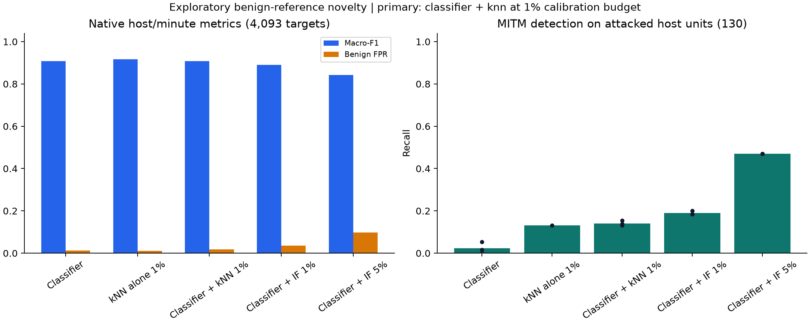
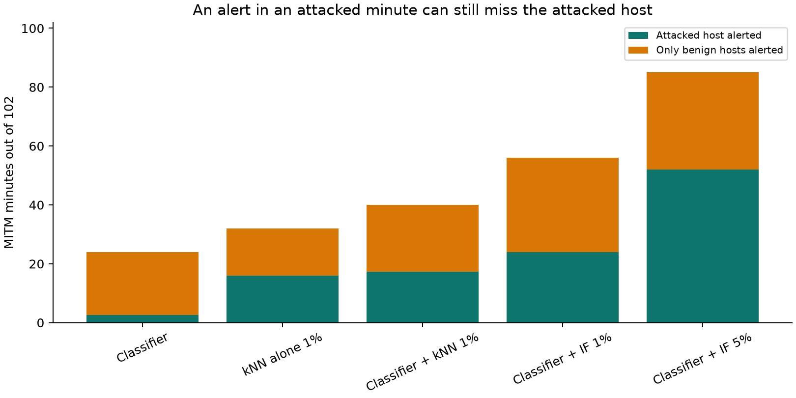

# ToN-IoT chronological host novelty: benign-reference controls

Completed on **9 November 2026**. The validation-selected classifier + kNN
combination detects **17-20 of 130 MITM host/minute units**, compared with
**0-7** for the fixed classifier. Mean native macro-F1 moves from **0.9079 to
0.9086**, while native benign false positives increase from **1.34% to 1.87%**.
On the same 718 global minutes, macro-F1 increases from **0.6583 to 0.6812** and
benign false positives increase from **15.56% to 20%**. This is a limited
exploratory gain, with most unseen MITM units still missed.

The separate, predeclared kNN-only control reaches **0.9176 native macro-F1**,
**1.11% native false positives** and **17/130 MITM units**. It remains a distinct
control, not a replacement selected after examining test performance. The
framework default and manuscript are unchanged.

## Fixed data roles and information available to each method

The [source-IP/minute parent](../revision-ton-iot-host-windows-v1/README.md)
provides the verified compact matrices and three fixed federated classifiers.
The extension retains the same corrected chronological inventories and source
occurrence policy: 67,959 host training units, 7,707 validation units and 4,093
test units. The test contains 3,336 benign, 627 backdoor and 130 MITM units on
29 April 2019. The common-minute assessment retains 718 targets, including
30 benign and 102 MITM minutes. Native and common metrics have different units.

The detector reference pool is a deterministic sample of **10,000 benign units**
from the parent's selected training sample. No attacked training row is used
to fit either detector or its normalization. The original 25 numeric aggregates
are transformed using log1p and a standard scaler fitted only on those selected
benign training units. Source addresses, dates, identifiers and family names
are not predictor inputs. The reference classifier and its scaler remain fixed.
MITM is absent from both training and validation, which the fit-boundary audit
checks explicitly. Backdoor and ransomware do have validation support.

Both novelty methods are **centralized numerical diagnostics with access to a
trusted labeled benign reference pool**. They are not federated private training
implementations and do not establish a live deployment in which that clean
pool is available. A novelty alert indicates deviation from the reference,
not proof of maliciousness, collusion or a failed TPM assessment.

## Two detectors and two frozen operating points

| Detector | Fixed configuration | Raw anomaly score |
| --- | --- | --- |
| k-nearest-neighbor reference | Five neighbors, Euclidean distance, brute-force search, one thread | Mean distance to the five reference neighbors |
| Isolation Forest | 256 trees, 256 samples per tree, random state 341593, one thread | Negative `score_samples` |

Each component threshold is fitted only on the **6,485 benign validation
scores**. For a budget alpha, the strict rule `score > threshold` permits at
most `floor(alpha * 6485)` calibration false alerts, with score ties kept
indivisible. The primary budget is **1%**, permitting 64 alerts, and **5%** is a
predeclared sensitivity permitting 324. Both methods attain those calibration
counts. These are empirical constraints on the calibration population, not
guarantees about future data or the combined detector.

The combination applies an OR to the fixed classifier flag and the component
novelty flag on the **same host/minute unit**. The classifier can already produce
false alerts, so the component's calibration budget is not a bound on the
combined false-positive rate. On common minutes, an OR over hosts adds another
unit change and can amplify false alerts. The report retains that comparison.

The study includes three classifier references, four detector-only controls
and twelve classifier/detector combinations, totaling **19 configurations**.
Only the primary 1% regime is eligible for selecting the novelty method. Mean
combined native validation macro-F1 across the three fixed classifier seeds is
**0.851723 for kNN** and **0.848306 for Isolation Forest**, so kNN is selected.
All detector choices, operating points and thresholds close before any new
test anomaly scores are computed. The 5% results and standalone controls are
retained without post-test promotion. The source dates were already examined
in prior studies, making the assessment exploratory rather than newly blind.

## Complete native host/minute results

Rows with classifier combinations report means across all three fixed parent
classifier seeds, with detection counts shown as ranges. A standalone detector
has one fixed fit. These are not three independent anomaly-detector refits.
Native test FPR uses 3,336 benign host/minute targets and native F1 uses all
4,093 host/minute targets.

| Configuration / calibration budget | Macro-F1 | Benign F1 | Attack F1 | Native benign FPR | MITM detected |
| --- | --- | --- | --- | --- | --- |
| Classifier reference | 0.9079 | 0.9687 | 0.8471 | 1.34% | 0-7/130 |
| kNN alone, 1% | 0.9176 | 0.9719 | 0.8633 | 1.11% | 17/130 |
| Classifier + kNN, 1% (primary) | 0.9086 | 0.9682 | 0.8490 | 1.87% | 17-20/130 |
| kNN alone, 5% | 0.8912 | 0.9602 | 0.8222 | 3.72% | 28/130 |
| Classifier + kNN, 5% | 0.8903 | 0.9598 | 0.8207 | 3.80% | 28/130 |
| Isolation Forest alone, 1% | 0.4695 | 0.8849 | 0.0541 | 3.21% | 24/130 |
| Classifier + Isolation Forest, 1% | 0.8900 | 0.9600 | 0.8201 | 3.65% | 24-26/130 |
| Isolation Forest alone, 5% | 0.6240 | 0.8787 | 0.3694 | 9.59% | 61/130 |
| Classifier + Isolation Forest, 5% | 0.8425 | 0.9333 | 0.7516 | 9.72% | 61/130 |



The primary kNN combination improves attacked-host MITM recognition but adds
benign false alerts, giving only a small native macro-F1 gain. The kNN-only
control has a better aggregate native tradeoff in this assessment while still
missing 113 of 130 MITM units. Neither result supports broadly reliable
recognition of unseen attack families.

Isolation Forest illustrates the sensitivity tradeoff. Its 5% combination
recognizes 61/130 MITM units but reaches **9.72% native false positives**, and
native macro-F1 falls to **0.8425**. At the 1% calibration operating point,
Isolation Forest alone has **3.21% test native false positives** and macro-F1
**0.4695**, showing that the benign calibration constraint does not provide
future false-positive control or useful overall attack recognition by itself.

## Common minutes and correct attacked-host support

The original 718-minute inventory is preserved. An any-host positive prediction
in a MITM minute is not counted as attacked-host detection unless an actually
attacked host/minute unit also raises an alert. The supported counts below
check that distinction. Common-minute FPR uses only 30 benign global minutes
and should not be confused with native host FPR or treated as a precise
operational estimate.

| Configuration / calibration budget | Common macro-F1 | Common benign FPR | MITM minutes with attacked-host alert | MITM minutes with only benign-host alerts |
| --- | --- | --- | --- | --- |
| Classifier reference | 0.6583 | 15.56% | 0-6/102 | 20-23 |
| kNN alone, 1% | 0.6781 | 13.33% | 16/102 | 16 |
| Classifier + kNN, 1% (primary) | 0.6812 | 20.00% | 16-19/102 | 22-23 |
| kNN alone, 5% | 0.6874 | 33.33% | 26/102 | 30 |
| Classifier + kNN, 5% | 0.6874 | 33.33% | 26/102 | 30 |
| Isolation Forest alone, 1% | 0.1264 | 40.00% | 24/102 | 31 |
| Classifier + Isolation Forest, 1% | 0.6699 | 40.00% | 24/102 | 32 |
| Isolation Forest alone, 5% | 0.3430 | 66.67% | 52/102 | 33 |
| Classifier + Isolation Forest, 5% | 0.6620 | 66.67% | 52/102 | 33 |



The primary combination supports attacked-host alerts in **16-19/102 MITM
minutes**, while another **22-23 minutes** contain alerts only on benign host
units. The Isolation Forest 5% combination produces any-host alerts in 85 MITM
minutes, but only 52 have attacked-host support and the remaining 33 are benign
coincidences. Its **66.67% common-minute benign FPR** prevents interpreting those
85 alerts as a successful general detector. A supported host/minute alert is
still not record-level causal attribution or proof of malicious intent.

## Reproduction, runtime and retained evidence

Seventy-four focused tests and the new library lint checks pass. Verification
freshly refits both novelty detectors, exactly matches their four validation/
test score sets, reloads the three unchanged classifier checkpoints and matches
all six parent score sets. All 19 test decision arrays, **76 native/common
validation/test metric sets** and **76 family localization metric sets** are
recomputed. Localization is checked using both scalar per-minute logic and
vectorized pooling. Benign-only normalization, calibration thresholds, role
isolation, absence of MITM before test and validation-only method selection
are verified. This extension does not train another FedAvg chain.

| Detector | Fit seconds | Validation scoring seconds | Test scoring seconds |
| --- | --- | --- | --- |
| knn | 0.000746 | 0.210777 | 0.097108 |
| isolation | 0.177789 | 0.050983 | 0.031819 |

Times are local one-thread measurements with the prepared matrices in memory.
They exclude source acquisition, feature normalization and report processing.
kNN fitting primarily stores its references, so query costs must accompany any
fit-time comparison. These numbers are not deployment throughput measurements.

Original CSVs remain in Windows Downloads and WSL reads them through mounted
paths when required. This extension reads the compact host aggregates without
another raw-data scan or a copy of the roughly 3.37 GB release into the WSL
distribution. The publication retains protocols, decision/score arrays, audits,
source snapshots, plots and checksums. Raw sources, prior publications, selected
classifier tensors and the thesis remain unchanged. No detector pickle or
duplicated compact source matrix is required for reproduction.

```bash
make test-ton-iot
make evidence-check STUDY=results/revision-ton-iot-host-novelty-v1
```

The executed controllers retain explicit study-specific sibling-directory
bindings, and their parent paths and hashes are recorded in the protocol.
Observed source-IP overlap, unproved physical-flow identity, the occurrence-only
input policy and previously examined test dates retain their parent boundaries.
Native class F1, MITM localization and common-minute alert utility remain
separate outcomes. No framework default, TPM policy, Byzantine defense or
independent-witness guarantee is promoted by this exploratory result.
