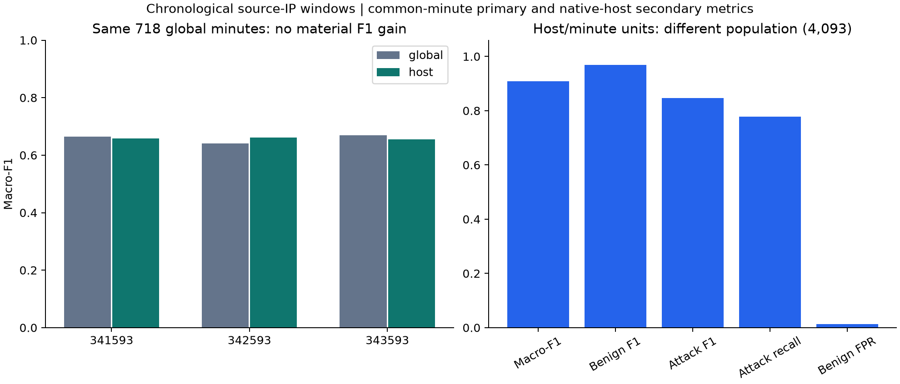
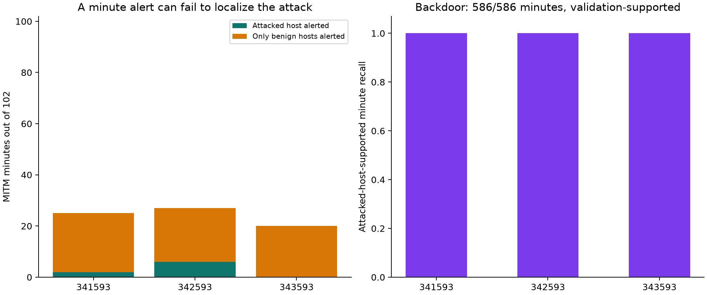

# ToN-IoT chronological source-IP/minute representation assessment

Completed on **9 November 2026**. Source-IP windows improve the representation
of benign traffic, giving **0.9079 mean native host/minute
macro-F1** and **1.34% native false positives**
across three federated seeds. The declared primary comparison on the original
718 global test minutes remains essentially unchanged: **0.6583**
for the host model and **0.6582** for its fresh global control.
The unseen MITM family remains poorly recognized. These are distinct findings,
and the native-unit F1 must not replace the failed common-minute result.

## Source reconstruction and the reason for changing granularity

The [previous same-role assessment](../revision-ton-iot-benign-robustness-v1/README.md)
shows that changing thresholds and traffic ratios does not resolve recent benign
false alerts. Global any-attack minute labels also absorb benign traffic into
positive examples whenever an attack occurs anywhere in the same minute.
The present assessment groups the same source records by canonical source IP
and UTC minute, preserving the original 25 aggregate definitions. The address
and timestamp are grouping metadata and never predictor inputs. A source IP
is an observed address, not an authenticated device, user or federated identity.

All 23 official network files are streamed from their existing ZIP/direct-file
locations and their row counts, byte counts and SHA-256 digests are rechecked.
The 869 preflight-rejected measurement/address-invalid occurrences remain
excluded under the same source-bound policy, leaving **22,338,152 occurrences**.
Missing categorical values retain their explicit category convention. No raw
CSV is copied or extracted, and no new data download is performed.

The result contains **80,172 source-IP/minute windows** and 23,413 distinct
canonical source addresses. Recombining the host accumulators reconstructs all
7,934 previous global windows with **zero difference in all 25 feature values**,
identical binary/type counts and unchanged global labels. The source ordinal
digests and per-file counts remain attached to each host window in the compact
lineage artifact. This checks numerical/source accounting for this preparation;
it is not new independently authenticated ingestion-completeness evidence.

## Same chronological roles, separate prediction units

The corrected parent inventories are retained: 6,061 training, 1,080 validation
and 718 test global minutes. Every host within a minute receives the same role,
including the one-hour embargo and conservative connection-end condition. All
test minutes are on 29 April 2019, with MITM absent from training and validation.
The host representation therefore does not move MITM examples into fitting or
change the earlier chronological test into an easier known-family partition.

| Role | Global minutes | Host/minute units | Benign host units | Attacked host units |
| --- | --- | --- | --- | --- |
| Training | 6,061 | 67,959 | 58,906 | 9,053 |
| Validation | 1,080 | 7,707 | 6,485 | 1,222 |
| Test | 718 | 4,093 | 3,336 | 757 |

The new training role contains benign host traffic from 23-27 April, in addition
to earlier captures. Those occurrences were already present in the official
records, but many previously belonged to globally attacked minutes. Source-IP
grouping exposes more representative benign units without labeling a whole
mixed minute as benign or using later test data for fitting.

Two evaluation levels are retained throughout:

1. **Common-minute primary:** the maximum host score in each minute, equivalent
   to an any-host alert at a fixed threshold, is compared against the unchanged
   global minute ground truth. This uses the same 718 test targets as the fresh
   global control, including 30 benign, 586 backdoor and 102 MITM minutes.
2. **Native host/minute secondary:** each host window is scored against its own
   any-constituent-attack label. This uses 4,093 targets, including 3,336 benign,
   627 backdoor and 130 MITM windows. Its F1 and FPR have different denominators
   and cannot be substituted for global-minute performance.

## Fitting, controls and validation-only selection

Fresh global and host classifiers use 15 synthetic IID clients, a binary
128/64/32 MLP, Adam at 0.001, binary-balanced cross entropy, two local epochs,
batch size 256 and 30 FedAvg rounds. Three fixed seeds are retained for both
profiles. Source IPs, family names, dates and identifiers are absent from
predictors. The 15 clients are numerical partitions, not the 23,413 observed
addresses or TPM-enrolled devices.

A deterministic uniform training-only cap selects at most 30,000 units per
profile, using the same sample across seeds. It retains all 6,061 global
training units and 30,000 of the 67,959 host training units. The 37,959 unsampled
host units are explicitly recorded as a learning-budget exclusion, not a source
ingestion omission. All validation and test units are scored. Log1p and scaling
are fitted only on the selected training sample, and balanced class weights and
client partitions are recomputed from that sample.

At every round, a threshold maximizes macro-F1 on the same 1,080 common
validation minutes. The best common-validation macro-F1 selects the checkpoint,
with earlier rounds preferred on ties. All choices close before scoring any
new-model test results. Six federated runs and four centralized Extra Trees /
histogram-boosting references are retained. Hyperparameters and training-role
rules match across representations, but unit counts, labels induced by grouping,
scalers and numbers of minibatches differ. This is a practical representation
intervention, not an equal-compute or single-factor causal proof.

## Results and what the improvement supports

The federated rows below average all three seeds. Different units are explicitly
named to prevent a misleading comparison of global macro-F1 with native F1.

| Prediction/evaluation unit | Macro-F1 | Benign F1 | Attack F1 | Attack recall | Benign FPR |
| --- | --- | --- | --- | --- | --- |
| Global model, common minutes | 0.6582 | 0.3747 | 0.9418 | 89.87% | 22.22% |
| Host model, common minutes | 0.6583 | 0.3801 | 0.9365 | 88.66% | 15.56% |
| Host model, native host/minutes | 0.9079 | 0.9687 | 0.8471 | 77.81% | 1.34% |



On common minutes the global control produces 3, 14 and 3 false positives among
30 benign targets, while the host model produces 5, 5 and 4. Native host false
positives are 48, 50 and 36 among 3,336 benign windows. Neither unit count is a
count of independent capture days or authenticated clients. The common-minute
F1 is essentially unchanged, despite better native benign representation.

| Configuration | Selected round | Common test macro-F1 | Native test macro-F1 | Native benign FPR | Fit + validation seconds | Test/report seconds |
| --- | --- | --- | --- | --- | --- | --- |
| global-s341593 | 26 | 0.6651 | 0.6651 | 10.00% | 15.43 | 0.092 |
| global-s342593 | 2 | 0.6407 | 0.6407 | 46.67% | 12.86 | 0.044 |
| global-s343593 | 25 | 0.6689 | 0.6689 | 10.00% | 12.54 | 0.041 |
| central-extra-trees-global | n/a | 0.6696 | 0.6696 | 56.67% | 0.74 | 0.095 |
| central-histogram-global | n/a | 0.6586 | 0.6586 | 6.67% | 1.04 | 0.069 |
| host-s341593 | 21 | 0.6580 | 0.9061 | 1.44% | 27.71 | 0.065 |
| host-s342593 | 25 | 0.6617 | 0.9078 | 1.50% | 30.40 | 0.089 |
| host-s343593 | 29 | 0.6553 | 0.9097 | 1.08% | 25.30 | 0.087 |
| central-extra-trees-host | n/a | 0.6931 | 0.9137 | 1.26% | 7.20 | 0.087 |
| central-histogram-host | n/a | 0.6640 | 0.9148 | 0.69% | 2.31 | 0.083 |

Timing is measured on this single-thread CPU execution. Fit timing includes
validation/selection, while test timing includes scoring, metric calculation
and artifact I/O; it is not isolated inference latency or deployment throughput.
Centralized references reach higher native F1 but also fail to provide strong
unseen-MITM localization. No test winner is promoted as a new default.

## Minute coincidence is not attacked-host detection

All three host models raise an alert on an actually attacked host/minute in
each of the 586 backdoor test minutes. Backdoor is represented in validation,
and this supports a qualified positive result for the declared assessment.
Native backdoor recall is 586/627 because some additional attacked host units
within those minutes are missed. This does not establish detection of every
malicious source record or a general attack-defense guarantee.

MITM is a different case. The host models recognize only **0, 2 or 7 of its
130 native attacked host/minute units**, depending on seed. Several global
minutes nevertheless contain positive predictions on unrelated benign host
units. Counting such coincident alerts as correctly localized MITM detection
would substantially overstate the result.

| Host configuration | Any-host alerts in MITM minutes | Minutes with an attacked-host alert | Benign-host-only coincident alert minutes |
| --- | --- | --- | --- |
| host-s341593 | 25/102 | 2/102 | 23 |
| host-s342593 | 27/102 | 6/102 | 21 |
| host-s343593 | 20/102 | 0/102 | 20 |
| central-extra-trees-host | 39/102 | 10/102 | 29 |
| central-histogram-host | 18/102 | 0/102 | 18 |



The source-IP grouping raises the median attack-row fraction in MITM units
from about **7.62% in global minutes to 100% in native host windows**. Poor
MITM detection persists despite this reduction in dilution. Reduced dilution
alone is therefore insufficient for this classifier and protocol. None of the
130 native MITM test feature vectors is an exact match to a benign or attacked
training vector, and no test vector group has opposite binary labels. Exact
feature collisions do not explain the failure, but their absence does not prove
that the existing features can reliably separate the family or that no other
learner could improve the result.

An attacked-host-supported alert still concerns a mixed host/minute label, not
causal attribution to a specific attack record. Temporal overlap, host overlap
and benign coincidences remain distinct from proof of malicious intent.

## Verification, storage and remaining boundary

Sixty-six focused tests and the new library lint checks pass. All 80,172 lineage
rows are compared with the compact matrix, source counts are accounted for,
and all 7,934 minute-level binary counts are reconstructed. The preparation
also verifies all 25 reconstructed features with zero error. All six selected
federated validation/test score sets are recomputed and all four centralized
references are freshly fitted, covering 40 native/common validation/test metric
sets. Thresholds, training samples, client partitions, scalers and installed
pooling behavior are checked. Two fresh 30-round replays match **60 global
tensor digests**, rerun **900 local updates** and recompute all-round validation
metrics; local-update digest comparison is not claimed. Ten family localization
metric sets are independently checked using vectorized pooling.

The raw source files, earlier sealed publications and manuscript remain
unchanged. The new matrix and compressed lineage occupy about 11.8 MB and stay
at their indexed execution path, without duplication in this publication.
Only selected new model states are retained, alongside every round's tensor
digest and validation history. The source profile retains all valid occurrences;
exact-projection duplicate sensitivity for the new grouping is not claimed.

The dates and source release have been examined in earlier studies, so this
is an exploratory reused chronological assessment, not a fresh blind test.
Of 4,093 native test units, 4,076 use addresses also present in training; source
addresses are not physical-device identities. Host independence, physical-flow
identity, operational calibration and general novel-family robustness remain
unproved. This is honest-client numerical classification, with no new TPM,
Byzantine-admission or independent-witness claim.

```bash
make test-ton-iot
make evidence-check STUDY=results/external-data/revision-ton-iot-host-windows-v1
```

Protocols, source snapshots, histories, score arrays, audits and a checksum index
are retained here. `execution-artifacts.json` identifies the compact input and
selected tensor files left in their original workspace. The executed controllers
have explicit study-specific sibling-directory bindings. The next research
question is detection of families absent from fitting and calibration, assessed
separately from benign support and minute-level alert coincidence. Positive
native benign performance does not close that question.
