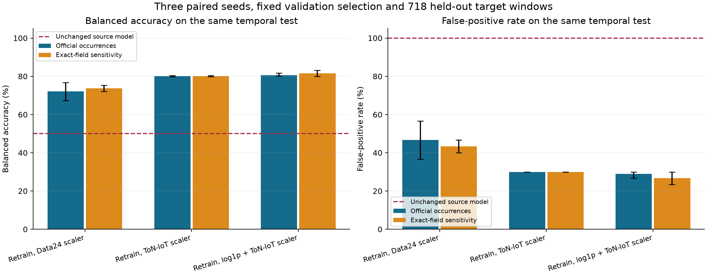
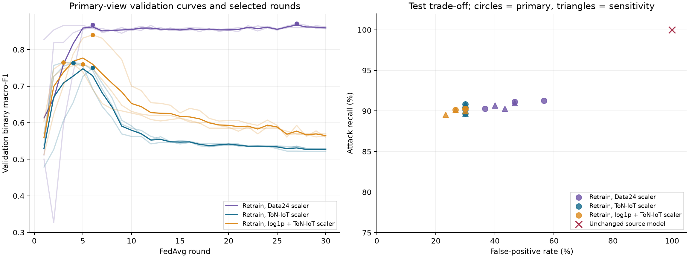

# ToN-IoT target-domain FedAvg diagnosis

Target-domain training recovers useful binary discrimination after the failed
source-only transfer, although the remaining false-positive rate prevents an
operational-readiness claim. The predeclared primary condition, which refits the
standard scaler on ToN-IoT training windows and trains a binary model from
scratch, reaches mean test balanced accuracy of **80.16%** across three seeds.
On the same test windows, the unchanged Data24 model has balanced accuracy of
50.00%. The new primary models still produce nine false alarms among only
30 benign test windows, giving a false-positive rate of **30.00%** for every seed.

This follow-up implements the agreed comparison between frozen-model transfer
and learning the same 25-feature representation on the independent dataset.
The [source preflight](../revision-ton-iot-preflight-v1/README.md) and
[unchanged transfer experiment](../revision-ton-iot-transfer-v1/README.md)
remain separate publications with their original results and input boundaries.

## Fixed protocol and temporal support

The experiment uses the previously verified 7,934 one-minute windows, retains
the official-occurrence view as primary and repeats every condition on the
prespecified exact-field duplicate sensitivity. Both views have the same
windows, temporal assignments and binary truth. No new raw-data copies or
source-record modifications are introduced.

| Role | Temporal assignment, UTC | Benign | Attack | Windows |
| --- | --- | ---: | ---: | ---: |
| Training | Through 27 April 2019, outside the boundary purge | 2,773 | 3,288 | 6,061 |
| Validation | 28 April through 23:00 | 85 | 1,010 | 1,095 |
| Test | 29 April | 30 | 688 | 718 |
| Excluded boundary windows | Hour before the next split boundary | 0 | 60 | 60 |

Whole minute windows and dates are disjoint across roles. A one-hour purge is
declared before the next role starts, and the observed natural capture gap
already separates the last training observations from validation. Hosts and
attack infrastructure can recur, so this is temporal isolation without a
host-disjoint or site-independent guarantee.

All target models use the original 25 inputs and 128/64/32 encoder with a new
two-output head, train from scratch for 30 FedAvg rounds with 15 simulated IID
clients and full participation, and use two local Adam epochs, batch size 128
and learning rate 0.001. The existing training function and Flower sample-count
aggregation are reused. Global square-root-balanced class weights are computed
from the 6,061 training labels. Client partitions and seed schedules are matched
across conditions, and seeds 341593, 342593 and 343593 are all retained.

This numerical profile assumes honest training clients. Attack-labelled network
traffic is supervised task data and does not constitute Byzantine update
poisoning. No new TPM admission, live attestation or ToN-IoT DBA campaign is
claimed. The original six-class Data24 model and its scaler remain unchanged.

## Preprocessing and checkpoint selection

Three conditions are fixed before fitting. `source-standard` retrains the
binary model while retaining the Data24 training-only scaler. The primary
`target-standard` condition fits a standard scaler on target training inputs.
`target-log1p` applies the existing log transformation to the ten count, duration,
byte and packet features, then fits its scaler on target training inputs. None
uses validation or test observations to fit preprocessing, and no threshold is
tuned. Binary predictions use the argmax of the new two-output head.

Each run selects the greatest validation macro-F1 across all 30 rounds and uses
the earliest round on ties. A closure records all 18 selections before any
target-model test evaluation. The primary preprocessing remains target standard
scaling, and all other conditions and seeds are reported without selecting a
preferred result on the test set. Comparisons with the unchanged source model
jointly change learned parameters and the task head, while comparisons among
the three retraining conditions hold those structures fixed and assess scaling.

## Results on the same temporal test

Values are means over the same three seeds. Ranges describe seed variation on
the same observations and are not confidence intervals for a new population.

| View | Retraining preprocessing | Balanced accuracy | Attack recall | False-positive rate | Binary macro-F1 | AUROC |
| --- | --- | ---: | ---: | ---: | ---: | ---: |
| occurrence | source-standard | 72.11% | 90.89% | 46.67% | 61.76% | 0.7884 |
| occurrence | target-standard | 80.16% | 90.31% | 30.00% | 64.99% | 0.8168 |
| occurrence | target-log1p | 80.66% | 90.21% | 28.89% | 65.09% | 0.9059 |
| exact-projection | source-standard | 73.66% | 90.65% | 43.33% | 62.35% | 0.7839 |
| exact-projection | target-standard | 80.16% | 90.31% | 30.00% | 64.99% | 0.8171 |
| exact-projection | target-log1p | 81.60% | 89.87% | 26.67% | 65.12% | 0.9101 |

The unchanged source model restricted to this same test has 100% attack recall,
100% false-positive rate and 50% balanced accuracy. The full earlier transfer
result covers 7,934 windows and is a different denominator; its figures are not
substituted into this paired comparison.



Bars show three-seed means and whiskers show the observed minimum and maximum.
The primary target-standard mean is 80.16% balanced accuracy, with a narrow
79.84%-80.42% seed range, mean attack recall of 90.31% and nine false positives
out of 30 benign windows for every seed. Repeating this primary condition on
the exact-projection sensitivity produces the same binary test decisions.

The log-transformed primary view has mean balanced accuracy of 80.66% and
false-positive rate of 28.89%, while its projection sensitivity reaches 81.60%
and 26.67%, respectively. These modest differences do not establish a reliable
new preferred configuration, and no default is changed on their basis. All
per-seed numerators, confusion matrices and ranking metrics are retained in
`target-test-results.json` and `per-run-results.csv`.

The test is strongly attack-dominated, so the unchanged all-positive classifier
already obtains 95.82% accuracy despite recognizing no benign window. The
primary retrained models have lower overall accuracy while recovering normal
class discrimination, which is why balanced accuracy, specificity and the
confusion matrix carry the interpretation. Attack F1 alone would also conceal
the false-alarm burden.

## Selection behavior and remaining errors



Thin validation curves represent individual seeds, thick curves their mean and
markers each validation-selected checkpoint. The primary standard-scaling
models peak early, at rounds 3, 4 and 6, and their later validation performance
declines. All runs still execute the fixed 30-round schedule, so using the final
round in place of the declared selection would give a different experiment.
The right panel displays every seed and both source-count views on the same
recall/false-positive trade-off.

All three primary seeds misclassify the same nine benign windows, and 62 attack
windows are missed by every primary seed. The post-test error audit found no
exact 25-feature vector associated with opposite observed labels in the
non-embargo inputs. Consequently, the current errors are not explained by a
demonstrated exact feature collision, and their inevitability under this
representation is not established. This descriptive audit changes no weights,
scalers, thresholds or selected checkpoints.

Training attack-type coverage and later-date coverage differ. Training includes
scanning, DoS, DDoS, injection, password and XSS traffic, validation includes
ransomware and backdoor traffic, and the test contains backdoor and MITM
traffic. These are source-type presences within binary windows, not mutually
exclusive per-type detection results. Validation has already exposed backdoor
traffic during checkpoint selection, so no completely unseen-family detection
claim is made. No type is forced into a MITRE class.

## Interpretation and uncertainty

The experiment supports a bounded positive conclusion: the 25-feature
representation contains learnable target-domain information, and refitting its
normalization alongside target learning improves this temporal binary task.
It does not show that the source classifier transfers unchanged or that the
representation is sufficient for every attack family. The original transfer
failure remains valid and the target results are separately versioned.

Only 30 benign windows are available in the test. For nine false positives, the
descriptive 95% Wilson interval is approximately 16.66%-47.88%. The calculation
treats windows as binomial observations and does not account for their temporal
dependence, and the three seeds do not turn these 30 windows into 90 independent
observations. A residual false-positive rate around 30% does not justify
operational deployment.

The target test date was already included in the earlier frozen-model
evaluation and the follow-up design was informed by that diagnosis. It is held
out from target fitting and checkpoint selection, but is not a newly blind
external test. The source data and time-disjoint target roles support a clear
diagnostic comparison within this scope. Further tuning on these test outcomes
would require a newly declared study and a separate assessment.

## Verification, storage and reproducibility

All 18 runs complete all rounds without numerical failure. Thirty-nine focused
package, window, split, preprocessing and selection checks pass. The verifier
checks all 540 retained global checkpoint digests and round chains, recomputes
the selected predictions of all 18 models through the established inference
function, and recomputes both unchanged-source baselines on the same test.
One complete primary run is freshly retrained, reproducing all 30 global tensor
digests, all 450 local update digests and every validation-selection score.
The other 17 training histories are checked as stored trajectories and are not
all freshly retrained by that verifier.

Compressed global checkpoints, prepared numeric inputs, selections and local
update digests occupy about 34 MB in the controlled study directory. Local
update tensors are not archived individually, and their deterministic seeds and
inputs are retained for reproduction. Publication integrity checks cover the
small retained report and metadata; they do not rerun training or authenticate
new TPM evidence. Runtime information and measured per-run training durations
are retained, and the latter include validation, checkpoint writing and
numerical training under the single-threaded CPU profile.

The exact source snapshots are under `sources/`, while the controlled study is
`output/ton-iot-retraining-20261109/study` in the local project workspace. The
original source CSVs, Data24 artifacts, previous reports and manuscript remain
unchanged. The explicit Make entry points prepare the declared protocol, train
the target models and evaluate only after the selection closure:

```bash
make test-ton-iot
make evidence-check STUDY=results/external-data/revision-ton-iot-retraining-v1
```

The `ton-iot-target-prepare`, `ton-iot-target-train` and
`ton-iot-target-evaluate` targets require explicit `TON_IOT_TRANSFER` and
`TON_IOT_TARGET_WORKSPACE` paths. They do not download data, alter the original
model, launch Docker or update the thesis.
