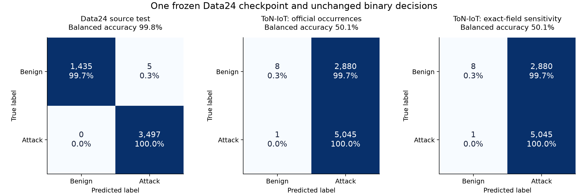
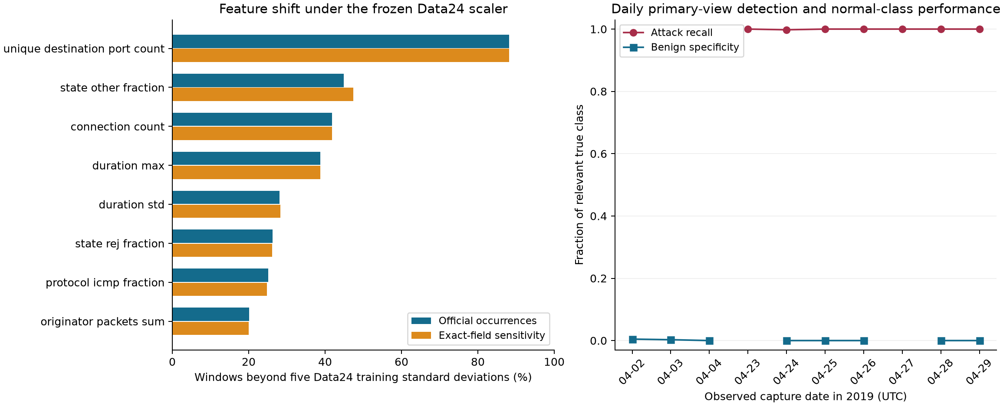

# Frozen Data24 transfer to the official ToN-IoT network release

The locally verified, validation-selected Data24 round-11 checkpoint performs
well on its retained Data24 test set but fails to provide a usable unchanged
binary decision rule on ToN-IoT. Of 2,888 benign ToN-IoT windows, 2,880 are
classified as attack. Almost-perfect attack recall therefore coexists with a
false-positive rate of 99.72% and balanced accuracy of only 50.13%.

The experiment follows the agreed sequence: preserve the Data24 model, scaler
and decision rule for an initial transfer test, inspect the failure and reserve
separate ToN-IoT retraining for the subsequent representation assessment.
No model, scaler or threshold was fitted on ToN-IoT in this publication.

## Protocol and retained inputs

All 23 official CSVs were read through their acquisition index without
extraction, and their source bytes were reverified on both construction passes.
The [record preflight](../revision-ton-iot-preflight-v1/README.md) identifies 869
malformed normal-labelled occurrences, which are excluded with source-bound
coordinates and reasons. The primary view retains the other 22,338,152 rows.
Unknown services remain in the existing other category.

The 25 existing feature definitions and 60-second UTC-day grouping are
preserved, including population duration standard deviation, payload-byte
semantics and global merging across CSV boundaries. A memory-conscious
accumulator retains duration arrays and category/count summaries, and produces
the same 25 values as the original window function. An independent source
check rebuilt 11 actual windows from 3,988 source rows, including two windows
crossing CSV boundaries, and matched every feature and binary label exactly.
This is a bounded independent source check, not a second full raw derivation.

The primary binary rule takes the argmax of the unchanged six-class model and
collapses every non-benign prediction to attack. It does not introduce a 0.5
threshold on summed attack probability. AUROC and average precision use
`1 - P(benign)` as threshold-free ranking diagnostics, which do not alter the
reported decisions. Window truth is attack if any retained constituent is an
attack. No ToN-IoT attack type is forced into a MITRE class.

## Duplicate assessment

The prespecified sensitivity groups rows with identical raw common non-label
fields, excluding the optional `uid`, `label` and `type`. Length-prefixed UTF-8
values are hashed with SHA-256. The earliest occurrence represents each group
and binary truth is unioned. In the observed data, no group contains conflicting
binary or attack-type labels.

There are 20,546,488 projection groups and 1,791,664 excess occurrences across
551,741 repeated groups. The largest group contains 2,014 occurrences. Equal
observed fields cannot establish repeated physical-connection identity because
most files lack `uid` and timestamps have the released precision. Consequently,
the official-occurrence view remains primary and projection collapse is a
sensitivity analysis. Neither view is chosen on the basis of external results.

Both views produce the same 7,934 minute windows and binary truth: 2,888 benign
and 5,046 attack windows. Projection collapse changes no binary prediction.
It therefore does not repair the observed transfer failure.

## Quantitative results

| Metric | Data24 source test | ToN-IoT primary | ToN-IoT projection sensitivity |
| --- | ---: | ---: | ---: |
| Accuracy | 99.90% | 63.69% | 63.69% |
| Balanced accuracy | 99.83% | 50.13% | 50.13% |
| Attack precision | 99.86% | 63.66% | 63.66% |
| Attack recall | 100.00% | 99.98% | 99.98% |
| Attack F1 | 99.93% | 77.79% | 77.79% |
| Benign specificity | 99.65% | 0.28% | 0.28% |
| False-positive rate | 0.35% | 99.72% | 99.72% |
| AUROC of the unchanged probability score | 0.9992 | 0.8935 | 0.8931 |
| Average precision of the unchanged score | 0.9984 | 0.8939 | 0.8935 |

The ToN-IoT confusion matrix, with rows as true labels and columns as predicted
labels in benign/attack order, is `[[8, 2880], [1, 5045]]` for both views.
The Data24 source control is `[[1435, 5], [0, 3497]]`. Evaluation units are
windows. Record-level class proportions are not substituted into these metrics.



The matrices display counts and row-normalized percentages. High external
attack recall is insufficient because nearly every normal window also triggers
an alert. The window-level constant-attack baseline is reported in
`transfer-results.json`; overall accuracy and attack F1 alone would conceal the
loss of normal-class discrimination.

## Diagnosis and interpretation

Under the frozen Data24 scaler, 99.95% of ToN-IoT windows have at least one
feature more than five training standard deviations from its reference mean.
Distinct destination-port count is outside that range for about 88.18% of
windows, and connection-state composition and connection-count features also
shift substantially. The duplicate sensitivity retains the same overall
out-of-range fraction and exactly the same binary decisions.



The feature panel shows the eight largest primary-view out-of-range fractions
alongside the prespecified sensitivity. The daily panel leaves a gap when the
corresponding true class is absent at window level. Several dates with normal
records have no wholly benign windows because normal rows share minutes with
attack rows. Per-day denominators and undefined metrics are retained explicitly.

The probability ranking has AUROC 0.8935 on these windows even though the
unchanged decision rule is almost always positive. This is evidence that the
frozen scores retain ordering information, and it separates ranking behavior
from a valid alerting rule. It does not validate a new operating threshold or
calibrated probabilities. The observed feature shift is consistent with domain
transfer failure, while this experiment does not isolate it as the sole cause.

The source control, independent source-feature checks and recomputed predictions
support a model-transfer diagnosis within the declared representation. Exact
projection collapse does not explain away the failure. A later assessment can
retrain the same representation on ToN-IoT and compare source-only transfer with
target-domain learning. Any calibration-only variant requires separate labelled
validation and a held-out test, and cannot be reported as unchanged transfer.

## Verification and reproducibility

Thirty-one focused package/window checks and three focused metric checks pass.
All 15,868 external predictions were independently recomputed through the
established `_predict` function using a different batch size, with every
six-class prediction and binary confusion matrix reproduced. All feature-vector
invariants and source count totals pass. Reference-campaign verification is
recorded separately; no new TPM attestation was performed for this numerical
external test.

The preparation protocol is fixed before source processing. An evaluation-plan
reader correction is retained before first ToN-IoT inference: the existing
Data24 test rows are nested under `rows/test`. The correction changes no model,
scaler, feature, decision rule or external outcome selection. `sources/` and
the protocol/plan files retain the exact executed implementation and bindings.
The scratch duplicate index was about 871 MB and was removed after its digest
and results were recorded. Raw CSVs and frozen training artifacts are unchanged.

## Reference-checkpoint discrepancy

The available, verified Data24 round-11 model is pinned by SHA-256
`39075d9cbf7c45248c475ae3ddfb66f0e032d55cc210eba2a9e97c19e3d594e5`.
The older published Data22 report names
`007e3fafd35f292eb72cc4c42c1f05b51210f90637af7da9b345d1e45a123e6e`.
They are not byte-identical, and the older hash was not found in the inspected
retained round-11 checkpoint paths. The cause of the historical difference is
not established. The Data22 report remains unchanged and this publication does
not claim a same-checkpoint Data22/ToN-IoT comparison. The current model is bound
to its own verified campaign, partition, selected round and training scaler.

## Scope and remaining work

These are correlated windows from ten observed source dates and one frozen
Data24 checkpoint. They do not establish population-wide performance, physical
connection deduplication, a ToN-IoT DBA-defense result or a newly attested live
campaign. Separate ToN-IoT retraining and a leakage-controlled target-domain
evaluation remain pending, and the manuscript has not been modified.

`make test-ton-iot` runs the package and window checks. `make ton-iot-windows`
requires an explicit source index, matching full preflight, frozen protocol and
fresh output path. The exact evaluation and verification controllers are
retained in `sources/` with their local controlled-input bindings. Stored
publication integrity is checked with:

```bash
make evidence-check STUDY=results/external-data/revision-ton-iot-transfer-v1
```
