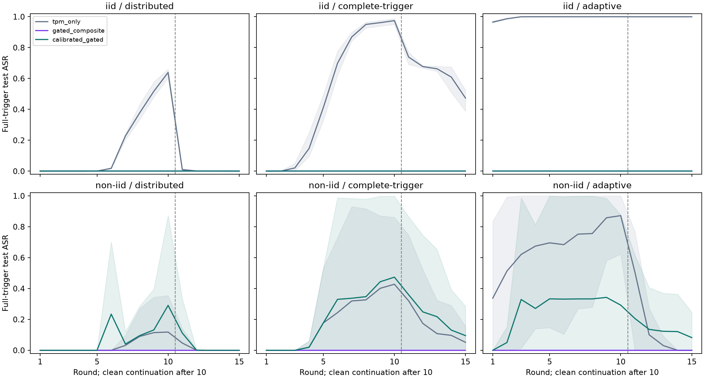

# Clean-only admission-gate calibration

Completed 2026-11-06. This study fits only on clean histories, selects only on separate clean validation histories, and reserves new seed/partition assignments for attacks and final test evaluation. The original gate/core code and old evidence are preserved. This is a software research adapter, not a new TPM campaign or a deployed runtime default.

## Finding and decision

Clean-only recalibration substantially reduces benign intervention and restores training availability, but does not meet the predeclared combined utility/security qualification. The calibrated arm completed 24/24 reserved campaigns; the original composite completed 18/24, with six real non-IID quorum failures, including a clean campaign. TPM-only completed 24/24. Missing checkpoints are undefined, not ASR zero.

On reserved clean assignments the calibrated gate retains at least 93.56% pooled nominal mass. Its worst fixed-endpoint test macro-F1 loss is about 0.0025 percentage points. However, at non-IID seed 2026110645 one round retains only 62.34% nominal mass, violating the 80% per-round budget despite 94.98% pooled retention. A good average does not establish a per-round guarantee.

Attack protection also weakens. At that same non-IID assignment the calibrated full-trigger peaks are 99.80% for the complete-trigger attack and 99.94% for the adaptive attack; final values remain 28.51% and 24.68%. IID full-trigger results remain zero in these tested assignments. Complete-case means and per-seed outcomes must be read together; the original rule's failed histories cannot serve as zero-ASR comparators.

This candidate is rejected for promotion. Improved clean behavior does not demonstrate a safe automatic exclusion rule. Further tuning on these reserved attack/test outcomes would be a new development study, not independent validation of this one.

## Clean protocol

- Four clean FedAvg histories fit references; four other histories calibrate thresholds; sixteen clean histories (four assignments by baseline/three candidates) choose a candidate. These stages never open the test split. Fitting accepts an explicit allowlist of five raw indicators, declared cohort, round and bound example counts; no attacker identities, poisoning labels or trigger outcomes. Existing clean-runner trigger diagnostics are excluded from fitting and selection.
- Same original five indicator weights, median/MAD score, cap 3, lambda 0.5, factor 0.5, minimum 10 contributors and Flower full-model FedAvg. The conditional reference uses round phases 1–5/6–10/11–15 and example-count ratio to the cohort median (<0.5, >1.5, otherwise middle); unsupported cohort/round fails. Reference cells need 30 observations, with a declared cohort/phase fallback.
- Global and conditioned candidates use empirical quarantine/downweight quantiles 0.975/0.90; conservative conditioned uses 0.99/0.95. Each cutoff is the larger of count-weighted and nominal-mass-weighted quantiles. Calibration-tail bounds are empirical only: dependent rounds/clients do not yield a future false-positive guarantee.
- All four clean selection assignments must meet Q<=5%, downweight<=15%, pooled nominal mass retained>=90%, each round>=80%, complete 15-round histories, validation macro-F1 loss<=2 points at rounds 10/15, and a nonempty quarantine region. Among feasible candidates minimize worst validation loss, maximize minimum mass retained, then use declared candidate order.
- All phases reuse the same Data24 global training occurrences and a fixed clean warm start. Their seed/partition assignments differ, but this is not independent data or initialization. Six held-out evaluation assignments have three IID and three Dirichlet alpha0.3 allocations. Historical test reuse remains exploratory; ToN-IoT is deferred.

## Clean selection

Selected candidate: **conditioned_conservative**. No attack or test outcome entered this decision.

| Candidate | All clean guards pass | Worst validation loss (pp) | Minimum pooled mass retained (%) |
|---|---|---:|---:|
| global | True | 1.18 | 92.66 |
| conditioned | True | 0.00 | 92.66 |
| conditioned_conservative | True | 0.00 | 95.55 |

Per-assignment counts, mass budgets and loss are in `selection.csv`; exact frozen references/thresholds and source manifest pins remain under the artifact models. A lower or higher cutoff cannot be compared directly across different reference normalizations.

## Reserved evaluation

All arms drive independent training from the same clean warm start. Three arms: TPM-only, original composite, selected calibrated composite. Clean/distributed/full-trigger/adaptive conditions use 15 rounds (10 attacked, 5 clean continuation), 50% poisoning at three clients, identical feature/row/query budgets to the prior study. Test is opened only after every evaluation case is terminal. Every failure is retained and missing models are undefined.

Cells show mean full-trigger **peak / final ASR (%)** over three assignments. Full/component ASR uses 3,497 non-benign test examples; clean macro-F1 uses all 4,937 examples. Seed/partition assignment, not client/round count, is the repetition unit.

| Cohort | Attack | TPM-only | Original composite | Calibrated composite |
|---|---|---:|---:|---:|
| iid | distributed | 63.90 / 0.00 (n=3/3) | 0.00 / 0.00 (n=3/3) | 0.00 / 0.00 (n=3/3) |
| iid | complete-trigger | 97.45 / 47.32 (n=3/3) | 0.00 / 0.00 (n=3/3) | 0.00 / 0.00 (n=3/3) |
| iid | adaptive | 100.00 / 99.97 (n=3/3) | 0.00 / 0.00 (n=3/3) | 0.00 / 0.00 (n=3/3) |
| non-iid | distributed | 11.81 / 0.00 (n=3/3) | 0.00 / 0.00 (n=1/3) | 29.10 / 0.00 (n=3/3) |
| non-iid | complete-trigger | 45.10 / 5.18 (n=3/3) | 0.00 / 0.00 (n=2/3) | 47.36 / 9.50 (n=3/3) |
| non-iid | adaptive | 87.21 / 0.00 (n=3/3) | 0.00 / 0.00 (n=1/3) | 34.79 / 8.23 (n=3/3) |

Peak/final cells use complete histories; n gives completed histories out of three. Prefix checkpoints of failed cases remain in `rounds.csv` and in the plot, but no absent final checkpoint is interpreted as zero. Conditional means with different n do not establish a fair superiority ranking.

## Reserved clean and attack guardrails

The calibrated policy passes every reserved clean budget: **False**. All predeclared research guardrails pass: **False**. This is not automatic production promotion.
Cases with worse paired worst-trigger peak harm than the original composite: **2/13 defined comparisons**; the other comparisons are undefined because a required history failed. Effective TPM-only comparisons with benefit: **12/18 defined comparisons**. The effective-control criterion requires >=20 points ASR increase with <=5 points clean F1 loss at a matched endpoint.

Paired harm is max over fixed rounds of (worst full/component ASR in the attacked history minus worst-trigger ASR of that policy's own clean history at the same round). This differs from comparing final ASR alone. `attack-comparison.csv` retains all cases and ineffective controls. No parameters were changed after reserved outcomes.

| Cohort | Seed | Policy | Q (%) | Downweight (%) | Mass retained (%) | Worst test loss (pp) | Qualified |
|---|---:|---|---:|---:|---:|---:|---|
| iid | 2026110641 | tpm_only | 0.00 | 0.00 | 100.00 | 0.00 | True |
| iid | 2026110641 | gated_composite | 8.44 | 55.11 | 64.00 | -2.17 | False |
| iid | 2026110641 | calibrated_gated | 4.44 | 4.00 | 93.56 | 0.00 | True |
| iid | 2026110642 | tpm_only | 0.00 | 0.00 | 100.00 | 0.00 | True |
| iid | 2026110642 | gated_composite | 2.22 | 60.44 | 67.56 | -2.95 | False |
| iid | 2026110642 | calibrated_gated | 0.00 | 0.00 | 100.00 | 0.00 | True |
| iid | 2026110643 | tpm_only | 0.00 | 0.00 | 100.00 | 0.00 | True |
| iid | 2026110643 | gated_composite | 12.44 | 33.33 | 70.89 | -2.81 | False |
| iid | 2026110643 | calibrated_gated | 1.78 | 1.78 | 97.33 | -0.12 | True |
| non-iid | 2026110644 | tpm_only | 0.00 | 0.00 | 100.00 | 0.00 | True |
| non-iid | 2026110644 | gated_composite | 25.71 | 68.57 | 23.37 | undefined | False |
| non-iid | 2026110644 | calibrated_gated | 0.00 | 0.00 | 100.00 | 0.00 | True |
| non-iid | 2026110645 | tpm_only | 0.00 | 0.00 | 100.00 | 0.00 | True |
| non-iid | 2026110645 | gated_composite | 21.78 | 60.00 | 32.40 | 1.89 | False |
| non-iid | 2026110645 | calibrated_gated | 0.89 | 0.00 | 94.98 | -0.14 | False |
| non-iid | 2026110646 | tpm_only | 0.00 | 0.00 | 100.00 | 0.00 | True |
| non-iid | 2026110646 | gated_composite | 20.44 | 58.67 | 37.31 | -0.69 | False |
| non-iid | 2026110646 | calibrated_gated | 0.00 | 0.00 | 100.00 | 0.00 | True |

`cases.csv` includes every planned run and failure; `aggregate.csv` includes SDs and contributing-case counts. `residuals.csv` compares final calibrated attacked models with their own clean control in parameter L2 and untriggered test predictions. Nonzero distance does not itself prove remaining harmful poisoning; zero ASR does not establish restoration.



Lines are available-case means and bands are observed ranges, not confidence intervals. The table averages per-run peaks; peak of the plotted mean is a different quantity. Failures remain explicit in tables.

## Structural score diagnostic

The selected non-IID statistical downweight cutoff is 0.926764; its quarantine cutoff is 0.949772. With five equally weighted component risks in [0,1], any zero component implies total risk <=0.8. Since the downweight cutoff exceeds 0.8, an admissible no-warning input with any zero component receives full nominal weight, regardless of the other four component values. This is an algebraic limitation of this averaged score/threshold combination, not proof that every such update is harmful.

All new reference banks and quantiles were independently refitted exactly. Count/mass tail bounds and pooled retained-mass lower bounds hold for the recorded calibration population only; `models-refit-verification.json` records them. They do not guarantee future client/round behavior or identify maliciousness. A structural revision must address signal compensation and heterogeneous clean behavior while keeping the mandatory trust veto separate; it cannot be justified by clean accuracy alone.

## Validation and scope

Verification counts: `{'clean_development_campaigns': 24, 'development_rounds': 360, 'development_queries': 0, 'development_local_repeats': 48, 'evaluation_rounds': 1040, 'evaluation_queries': 1080, 'evaluation_local_repeats': 138}`. Source and phase pins are in `summary.json`. All 27 focused tests passed. Saved raw indicators, weights, profile lookup, admission decisions and Flower outputs were reconstructed from original exports; first/final local training repeats and adaptive query replays are recorded per phase.
Trust prerequisites are assumed passed in this numerical experiment. Core hard-veto code is unchanged; no hardware appraisal or live M5 conditional-reference integration is claimed. Reference timing and cohort metadata require binding before such an integration. The test was previously inspected and the finite seed study supports conditional empirical conclusions only. No permanent client exclusion is justified by these counts. The thesis is unchanged.

## Reproduction

Preserve every existing destination. The source-locked controller resumes closed stages and refuses conflicting evidence.

```bash
.venv/bin/python scripts/revision_clean_gate_study.py pipeline --workers 3
.venv/bin/python scripts/revision_clean_gate_audit.py evaluation --workers 3
.venv/bin/python scripts/report_clean_gate_study.py
```
