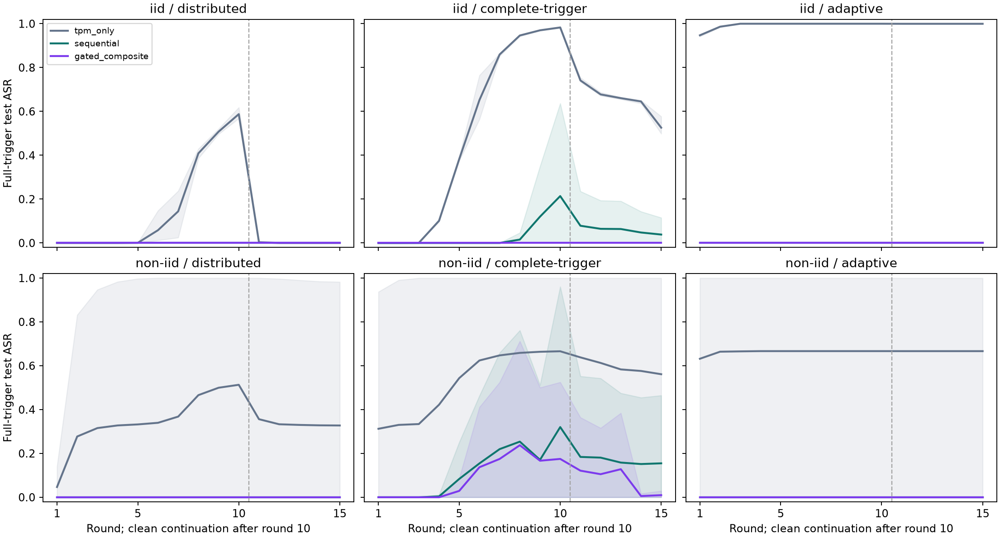

# Independent admission-gate trajectories

Completed 2026-11-06. All 72 planned campaigns completed 15 rounds: 1,080 deployed transitions and 16,200 retained local update exports. This is a software numerical research profile with mandatory trust assumed passed, not a new TPM campaign. The operational gate source, original calibration and thesis are unchanged.

## Decision supported by this study

Gated Composite provides an observed containment benefit over Sequential for the complete-trigger attack in these independently trained histories. The benefit comes from graded weighting and the resulting later trajectory, not a different no-warning same-input quarantine boundary. This is a scenario-specific numerical result, not a universal superiority or detection theorem.

The original calibration does not meet the predeclared clean-utility guardrail on every assignment. At non-IID seed 2026110605, round 10, clean macro-F1 falls by 6.07 percentage points for Sequential and 5.94 points for Composite relative to paired TPM-only. At round 15, the Composite loss is still 2.74 points. Improved cohort means do not erase this counterexample.

The hardest Composite complete-trigger case (the same non-IID assignment) reaches 71.20% full-trigger ASR and ends at 2.89%. Its distributed and adaptive full-trigger ASR is zero, but worst component-trigger peaks reach 10.38% and 7.89%, respectively. Full-trigger zero must not be presented as zero for all trigger variants.

On clean non-IID campaigns, Composite quarantines 127/675 honest contributions and downweights 377/675: intervention on 74.67% of observations. Only 35.74% of repeated nominal honest mass is retained. This is not a normalized-influence percentage, and it does not itself prove poor predictive performance. It does show a substantial intervention cost.

Do not promote either statistical policy as operationally validated under this frozen calibration. A subsequent clean-only calibration study must address heterogeneous clients and explicitly budget benign intervention and worst-assignment utility; it must use separately declared evaluation assignments. The present unfavorable outcomes remain part of the evidence. No new threshold is installed here.

## Protocol and interpretation

- Three original gates: TPM-only, Sequential and Gated Composite. Each drives its own subsequent local training. The original Flower full-model weighted FedAvg backend is fixed for every arm; no robust/clipped operator is mixed into this comparison.
- Six newly reserved seed/identity assignments and fresh training allocations: three IID and three label-Dirichlet alpha 0.3, using the same 7,096 global Data24 training occurrences. The source scaler and global class weights are preserved. These are training-only research allocations using the M3 allocation algorithms, not complete new M3 release profiles.
- Same fixed clean warm-start checkpoint for all cases, rather than six independently initialized models. Fifteen clients; ten local Adam epochs; batch size 128; learning rate 0.001. The preflight seed is excluded.
- Four conditions per policy/assignment: clean, fixed distributed DBA, fixed complete-trigger attack and defender-specific adaptive distributed attack. Poison 50% of hash-selected local training rows at three clients; target benign; trigger features 13/17/24 at standardized value 12. Distributed/full variants share selected row budgets but differ in feature-edit budgets. This is a feature-space attack, with no primary-log realizability claim.
- Attack rounds 1–10; unmodified continuation 11–15. Adaptive candidates alpha={0,.25,.5,1,2,4} interpolate/amplify clean and poisoned local endpoints. Six validation queries per active round, optimized separately against each defender, maximize worst full/component-trigger ASR after its actual aggregation. Ties prefer fewer attacker-slot quarantines, then larger alpha. Alpha0 is reported as no actual manipulated exports.
- Frozen original references, five equal indicator weights, statistical quarantine threshold 0.8183094063145846, composite threshold half that value, factor 0.5 and minimum 10 contributors. No calibration or parameter fitting was performed. The inherited source-training JSON also contains historical ancillary fields, including minimum_contributors8; those fields are unused by this runner. The bound runtime-admission settings govern the actual gate/quorum.
- Fixed endpoints at rounds 10 and15, full-horizon peak and attack-window mean ASR were declared before execution. Test inference occurred only after all 72 training cases had terminal evidence. The test split was used in earlier research: this is exploratory reuse, not untouched confirmation or independent-dataset evidence. Neither test outcomes nor these charts select a model or change a threshold.
- Full/component ASR targets benign among all 3,497 non-benign test examples, not just the reconnaissance subset used in some earlier studies. Clean accuracy/F1 uses all 4,937 test examples. The independent repetition unit is the seed/partition assignment; each cohort has three. Rounds and client decisions are not independent detection trials.

The retained protocol has SHA-256 `ffe8ac76aa93026c741e9c2af617b9653fa3b627b86901c451a89c30bc88b4ff`. Its case evidence is preserved under `artifacts/revision-gate-trajectories-v1`; source files and original update bytes are not overwritten.

## Full-trigger outcomes

Cells show **mean peak / mean final full-trigger test ASR (%)**, across three assignments per cohort. Every case is reported, including controls that fail the declared attack-effectiveness criterion. Final zero after five clean continuation rounds does not by itself show that a defense prevented the attack.

| Cohort | Attack | TPM-only | Sequential | Gated Composite |
|---|---|---:|---:|---:|
| iid | distributed | 58.76 / 0.02 | 0.00 / 0.00 | 0.00 / 0.00 |
| iid | complete-trigger | 98.30 / 52.59 | 21.57 / 3.84 | 0.00 / 0.00 |
| iid | adaptive | 100.00 / 99.97 | 0.00 / 0.00 | 0.00 / 0.00 |
| non-iid | distributed | 51.30 / 32.74 | 0.00 / 0.00 | 0.00 / 0.00 |
| non-iid | complete-trigger | 66.59 / 56.12 | 32.02 / 15.48 | 23.73 / 0.96 |
| non-iid | adaptive | 66.66 / 66.65 | 0.00 / 0.00 | 0.00 / 0.00 |

Exact per-seed round 10, final, peak and attack-window means are in `cases.csv`; `aggregate.csv` also includes component/worst-trigger outcomes, denominators, sample SDs and available-case counts. No equivalence or significance claim is made from three assignments per cohort.



Lines are the descriptive means; shaded bands are the observed range of three assignments, not confidence intervals. The dashed line separates attack and clean-continuation rounds. All branches completed, so no absent checkpoint is plotted as ASR zero.

## Clean utility and benign intervention cost

Clean campaigns contain no poisoned training. Quarantine/downweight counts below pool 675 repeated client/round observations per cohort/policy. A downweight retains half nominal mass and is not an exclusion or proof of maliciousness.

| Cohort | Policy | Final clean macro-F1 (%) | Quarantines /675 | Downweights /675 | Nominal mass retained (%) |
|---|---|---:|---:|---:|---:|
| iid | tpm_only | 92.16 | 0 | 0 | 100.00 |
| iid | sequential | 93.13 | 23 | 0 | 96.59 |
| iid | gated_composite | 94.03 | 30 | 257 | 76.52 |
| non-iid | tpm_only | 88.94 | 0 | 0 | 100.00 |
| non-iid | sequential | 91.01 | 127 | 0 | 57.59 |
| non-iid | gated_composite | 91.96 | 127 | 377 | 35.74 |

The largest paired fixed-endpoint clean macro-F1 loss against TPM-only is **6.07 percentage points**. The predeclared clean-utility guardrail was 2 points. `clean-utility.csv` contains every seed and both fixed endpoints; a negative loss means higher observed F1. Nominal mass retention counts repeated training-sample weight, not unique data coverage or normalized influence.

## Admission during attacked campaigns

The following counts pool the six assignments in each attack/policy cell. “Unmodified” includes the continuation rounds and alpha0 adaptive exports. Labels are evaluation-only and do not enter gate scoring. Quarantining a poisoned export is not proof that every retained export caused damage; admitting one is not proof of benignity.

| Attack | Policy | Manipulated exports | Manipulated quarantined | Manipulated downweighted | Unmodified quarantined / total | Unmodified downweighted |
|---|---|---:|---:|---:|---:|---:|
| distributed | tpm_only | 180 | 0 | 0 | 0 / 1170 | 0 |
| distributed | sequential | 180 | 125 | 0 | 97 / 1170 | 0 |
| distributed | gated_composite | 180 | 127 | 52 | 101 / 1170 | 550 |
| complete-trigger | tpm_only | 180 | 0 | 0 | 0 / 1170 | 0 |
| complete-trigger | sequential | 180 | 96 | 0 | 106 / 1170 | 0 |
| complete-trigger | gated_composite | 180 | 95 | 70 | 109 / 1170 | 531 |
| adaptive | tpm_only | 180 | 0 | 0 | 0 / 1170 | 0 |
| adaptive | sequential | 171 | 24 | 0 | 120 / 1179 | 0 |
| adaptive | gated_composite | 165 | 21 | 117 | 131 / 1185 | 519 |

The predeclared effective-control rule requires at least one same-round paired increase of 20 percentage points in worst-trigger ASR, with at most 5 points clean macro-F1 loss. The TPM-only controls meeting it are:
- distributed: 5/6.
- complete-trigger: 5/6.
- adaptive: 5/6.

`control-effectiveness.csv` retains every case and qualifying rounds. A control failing this joint criterion is inconclusive for the declared mitigation comparison; it is not silently discarded or declared impossible to attack.

## Residual differences from paired clean trajectories

Among the **39 final attacked endpoints with zero full-trigger ASR**, 39 have nonzero parameter L2 distance from their own paired clean model and 36 have at least one different untriggered test prediction. `residuals.csv` also gives round 10 results, exact disagreement counts and denominators.

A parameter difference is not by itself evidence of remaining harmful poisoning. It can include the defense response and changes in later honest training. These checks prevent “ASR zero” from being misrepresented as model restoration or removal of every attack-induced trajectory difference.

## Computational cost

Per-case stage medians are retained in `cases.csv`. Statistical work includes geometry, validation inference and all policy decisions; it is performed even for TPM-only to match the current in-round wrapper. A legacy TPM-only path without those calculations is not benchmarked here. Offline trust appraisal is assumed, so its real TPM/Quote latency is unavailable, not measured as zero. Aggregation timings measure a repeated reconstruction call. Adaptive-search timing includes poisoned endpoint training and candidate scoring/aggregation/evaluation; its selected candidate timings overlap and must not be added again as independent elapsed cost. Three concurrent single-threaded CPU workers were used; these are observed wall timings under that execution load.

The following are medians across per-case medians, with adaptive search restricted to the six adaptive cases per policy. Different trajectories/workloads remain visible in the raw stage records.

| Policy | Local population training (s) | Statistics and decisions (ms) | Aggregation replay (ms) | Six-query adaptive search (s) |
|---|---:|---:|---:|---:|
| tpm_only | 0.836 | 297.494 | 2.639 | 3.848 |
| sequential | 0.817 | 288.577 | 2.596 | 4.021 |
| gated_composite | 0.819 | 292.259 | 2.591 | 3.895 |

## Verification and limits

- Reconstructed 1080 deployed rounds from saved original model updates, including cohort indicators, validation impacts, policy vectors, exact masses, normalized coefficients and the Flower checkpoint bytes.
- Reconstructed 1080 adaptive queries, including candidate update hashes, decisions, feasibility, full/component validation ASR objectives and selected alpha.
- Verified 1080 exact numerical no-band/Sequential controls and 144 independent local-training repetitions at fixed rounds 1 and 15.
- Verified software experiment manifest signatures and all inventoried file hashes for every case. No fresh TPM Quotes or per-client hardware signatures are claimed by this study; prior live TPM integration evidence is separate.
- All 24 focused tests passed, including exact-weight, quorum and no-band numerical controls. The existing two Typer/Click deprecation warnings remain unrelated.
- During validation-only auditor smoke, NumPy was initially initialized before the single-thread environment; fixing import order restored exact reconstruction. The first full-audit attempt stopped before test reading because a manifest pin had an absolute key while its lookup used a relative key. The corrected audit is preserved as `post-training-evaluation-v2`; the original failed attempt and log remain. Training and its frozen controller were not changed.
- One dataset, one fixed warm start, three new allocations per cohort, a limited six-query adaptive family and assumed passed trust do not establish universal robustness, calibrated maliciousness probabilities, warning-value utility or permanent client exclusion. ToN-IoT remains deferred.

## Reproduction

Use `inventory-final.json` for the final reviewed report. The earlier inventory and initial publication check are retained as intermediate publication receipts. Numerical CSV/JSON results and signed campaign evidence were not rewritten.

The generation controller refuses an existing fresh destination and preserves completed case results. Do not delete prior evidence to rerun it. The immutable protocol and controller copy record exact inputs and the actual stage resolution. A new full generation requires a separately versioned destination/lock.

```bash
.venv/bin/python scripts/revision_gate_trajectories.py prepare
.venv/bin/python scripts/revision_gate_trajectories.py run --workers 3
.venv/bin/python scripts/revision_gate_trajectories_audit.py --workers 3 --output-root artifacts/revision-gate-trajectories-v1/post-training-evaluation-v2
.venv/bin/python scripts/report_gate_trajectories.py
.venv/bin/python -m pytest -q tests/test_gate_trajectories.py tests/test_gate_mechanism_properties.py tests/test_composite_admission.py tests/test_admission.py
```

All destinations above already exist after this completed run. To repeat the saved-input audit, use a fresh `--output-root`; retain every previous audit. The publication binds the selected audit summary explicitly rather than automatically choosing a favorable result. The thesis remains unchanged.
