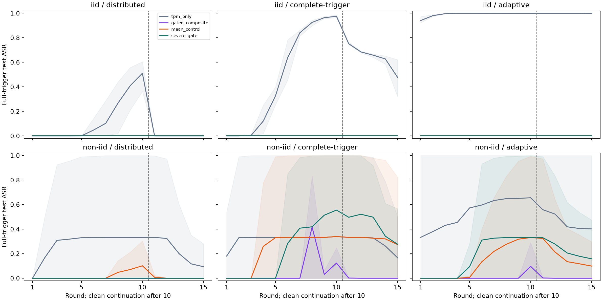
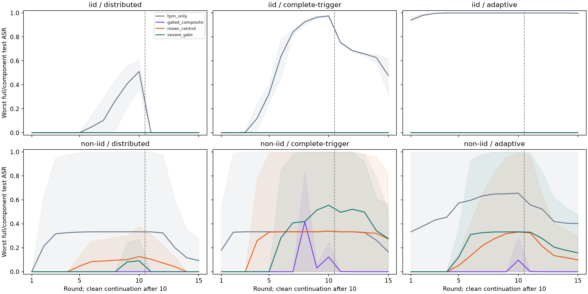

# Non-compensatory severe-tail admission study

Completed 2026-11-06. This is a structural research revision of statistical admission, with the original mandatory trust veto and full-model Flower FedAvg retained. Production defaults, old experimental evidence and the thesis were not edited. Trust validity is assumed in these numerical experiments; no new TPM appraisal is claimed.

**Outcome:** The proposed profile does not meet every predeclared research guard. At least one reserved clean utility, intervention or mass budget failed. The proposed gate has greater paired peak harm than the matched average in at least one reserved case. Fewer than two strict improvements over the matched average occur in effective-control cases.

## Rule and precise property

The previous capped equal-weight mean had a concrete blind region: if one of five components was zero, the average could not exceed 0.8 even when the other four saturated. A quarantine cutoff above 0.8 therefore could not fire in that situation. This revision removes both the former saturation and the averaging step. It does not assume that every successful attack creates a severe statistical tail.
For each original server-visible indicator, compute an adverse deviation from its conditioned clean median. Scale by max(1.4826*MAD,1e-9*max(1,abs(median))), retain log(1+deviation/scale) without the former z cap, and divide by its clean per-indicator 95th-tail normalizer (at least 1). Fuse the five values by their maximum M. The bounded display score M/(1+M) is monotone and is not a probability.
A component above the operational quarantine threshold forces the maximum above it regardless of the other four components. A normal component cannot cancel a severe alarm. The original G=0 trust veto remains prior to statistical acceptance. These are conditional algebraic/implementation properties, not guarantees that every poison update is an outlier or every outlier malicious.
Full per-component evidence is stored in severe_tail_details. The additive weighted-component schema is intentionally absent from the new signal; it would misdescribe a maximum. Reference/profile/model hashes, decisions and actual ordered weights remain replayable.

## Frozen clean-only protocol

- Eight clean FedAvg histories fit references, eight other clean histories calibrate per-indicator and joint tails; eighteen clean histories select between max_tail and max_tail_conservative against TPM-only on six separate assignments. None of these stages opens test. No attacker identities or trigger outcomes enter fitting/selection.
- Reference groups use declared cohort, campaign-round phase (1–5/6–10/11–15) and example count relative to the cohort median (<.5, >1.5, otherwise middle), with minimum 30 clean observations and declared fallback. Counts must be bound metadata, not unverified client claims. Unknown cohort/round is unsupported.
- Tail cutoffs use the larger count- and nominal-mass-weighted empirical quantiles. max_tail uses Q=.975,D=.90; conservative uses Q=.99,D=.95. These yield arithmetic bounds for the recorded calibration population, not future false-positive guarantees under dependent client/round observations.
- Every clean selection assignment must have Q<=5%,D<=15%,pooled nominal mass retained>=90%,each round>=80%,complete training and <=2 percentage-point validation F1 loss at rounds 10/15. Rank feasible candidates by worst validation loss, then minimum mass retained, then fixed order. Failed candidates remain reported.
- Same Data24 global training rows, fixed clean warm start, scaler and class weights; independently reserved seed/partition assignments per stage, not independent datasets or initializations. Three IID and three Dirichlet alpha.3 evaluation assignments. The historical test split was previously inspected, so results are exploratory.

Selected candidate: **max_tail_conservative**.

| Candidate | Clean qualification | Worst validation loss (pp) | Minimum pooled mass retained (%) |
|---|---|---:|---:|
| max_tail | False | 2.44 | 89.98 |
| max_tail_conservative | True | 0.35 | 94.60 |

## Reserved four-method evaluation

Four methods drive independent histories: TPM-only, original composite, the previous conservative capped-average recipe fitted on the SAME fresh clean histories, and the selected severe-tail gate. This tests the combined tail/fusion revision; it does not independently isolate every changed subcomponent. The mean control is never selectable as the proposed gate.
Each method/assignment has clean, distributed DBA, complete-trigger and defender-specific adaptive branches: 96 planned histories, 15 rounds each, attacks 1–10 then 5 clean continuation. Same 50% poisoned row budget at three clients, features 13/17/24 at 12, and six adaptive alpha queries 0,.25,.5,1,2,4. Adaptive exports interpolate/extrapolate from clean toward poisoned local models; alpha=0 is an unmodified export and alpha>1 is model scaling beyond the poisoned endpoint. The search maximizes worst full/component validation ASR, breaking ties by fewer attacker quarantines and larger alpha; it does not constrain clean F1. Effective-control qualification checks clean F1 separately. Triggers act in standardized feature space; PCAP realizability is not claimed. Test is evaluated only after all training cases are terminal.

Cells show **mean full-trigger peak / final ASR (%) [completed/3]**. Means exclude undefined full histories; prefix results/failures are preserved, never imputed as zero. Full/component ASR uses 3,497 non-benign test examples; clean F1 uses 4,937.

| Cohort | Attack | TPM-only | Original composite | Fresh mean control | Severe-tail gate |
|---|---|---:|---:|---:|---:|
| iid | distributed | 51.11 / 0.00 [3/3] | 0.00 / 0.00 [3/3] | 0.00 / 0.00 [3/3] | 0.00 / 0.00 [3/3] |
| iid | complete-trigger | 97.51 / 47.80 [3/3] | 0.00 / 0.00 [3/3] | 0.00 / 0.00 [3/3] | 0.00 / 0.00 [3/3] |
| iid | adaptive | 100.00 / 99.78 [3/3] | 0.00 / 0.00 [3/3] | 0.00 / 0.00 [3/3] | 0.00 / 0.00 [3/3] |
| non-iid | distributed | 33.32 / 9.39 [3/3] | 0.00 / 0.00 [2/3] | 10.12 / 0.00 [3/3] | 0.00 / 0.00 [3/3] |
| non-iid | complete-trigger | 33.90 / 16.65 [3/3] | 41.62 / 0.00 [2/3] | 33.90 / 27.42 [3/3] | 55.53 / 27.69 [3/3] |
| non-iid | adaptive | 65.58 / 40.18 [3/3] | 9.67 / 0.00 [3/3] | 33.13 / 9.88 [3/3] | 33.30 / 15.80 [3/3] |

Incomplete histories (no full-horizon ASR is inferred):

- `non-iid-s2026110735-gated_composite-complete-trigger`: 1 completed rounds; minimum ten contributors not reached at attempted round 2.
- `non-iid-s2026110735-gated_composite-distributed`: 1 completed rounds; minimum ten contributors not reached at attempted round 2.

## Predeclared guards

Proposed histories all complete: **True**. Every reserved clean/test budget passes: **False**. Combined research guards pass: **False**. No automatic production promotion.
Primary mean-control comparisons defined: **18/18**; proposed harm is worse in **2**. Strict mean-control benefits in effective-control cases: **1**, including **1** non-IID cases. Original-composite comparisons defined: **16/18**; proposed harm is worse in **3**. Undefined original comparisons cannot establish equivalence or superiority.
Paired harm is the maximum over fixed rounds of attacked worst full/component-trigger ASR minus the same method's own clean worst-trigger ASR at that round. An effective TPM-only control needs at least 20 points paired ASR increase with at most 5 points clean F1 loss. Do not infer prevention from final ASR alone. Negative clean F1 loss means improvement; mass and intervention budgets are still checked independently.

| Cohort | Seed | Method | Complete | Q (%) | Downweight (%) | Mass retained (%) | Minimum round (%) | Worst test loss (pp) | Qualified |
|---|---:|---|---|---:|---:|---:|---:|---:|---|
| iid | 2026110731 | tpm_only | True | 0.00 | 0.00 | 100.00 | 100.00 | 0.00 | True |
| iid | 2026110731 | gated_composite | True | 4.00 | 28.44 | 81.78 | 70.00 | -0.72 | False |
| iid | 2026110731 | mean_control | True | 0.00 | 3.56 | 98.22 | 96.67 | 0.73 | True |
| iid | 2026110731 | severe_gate | True | 0.44 | 4.89 | 97.11 | 93.33 | 0.67 | True |
| iid | 2026110732 | tpm_only | True | 0.00 | 0.00 | 100.00 | 100.00 | 0.00 | True |
| iid | 2026110732 | gated_composite | True | 7.56 | 50.67 | 67.11 | 56.67 | -0.03 | False |
| iid | 2026110732 | mean_control | True | 0.89 | 4.89 | 96.67 | 90.00 | 0.25 | True |
| iid | 2026110732 | severe_gate | True | 0.00 | 3.56 | 98.22 | 93.33 | 0.00 | True |
| iid | 2026110733 | tpm_only | True | 0.00 | 0.00 | 100.00 | 100.00 | 0.00 | True |
| iid | 2026110733 | gated_composite | True | 2.67 | 38.22 | 78.22 | 60.00 | -3.14 | False |
| iid | 2026110733 | mean_control | True | 0.00 | 0.89 | 99.56 | 96.67 | -0.30 | True |
| iid | 2026110733 | severe_gate | True | 0.00 | 2.67 | 98.67 | 93.33 | -0.30 | True |
| non-iid | 2026110734 | tpm_only | True | 0.00 | 0.00 | 100.00 | 100.00 | 0.00 | True |
| non-iid | 2026110734 | gated_composite | True | 15.11 | 53.33 | 36.48 | 20.47 | -12.78 | False |
| non-iid | 2026110734 | mean_control | True | 4.44 | 1.33 | 75.39 | 67.90 | -21.63 | False |
| non-iid | 2026110734 | severe_gate | True | 1.78 | 7.56 | 79.58 | 67.33 | -21.54 | False |
| non-iid | 2026110735 | tpm_only | True | 0.00 | 0.00 | 100.00 | 100.00 | 0.00 | True |
| non-iid | 2026110735 | gated_composite | True | 16.89 | 75.11 | 33.70 | 25.29 | -17.54 | False |
| non-iid | 2026110735 | mean_control | True | 0.00 | 0.00 | 100.00 | 100.00 | 0.00 | True |
| non-iid | 2026110735 | severe_gate | True | 6.22 | 4.89 | 75.17 | 67.76 | -9.39 | False |
| non-iid | 2026110736 | tpm_only | True | 0.00 | 0.00 | 100.00 | 100.00 | 0.00 | True |
| non-iid | 2026110736 | gated_composite | True | 26.67 | 62.22 | 23.44 | 16.26 | -3.34 | False |
| non-iid | 2026110736 | mean_control | True | 0.44 | 0.44 | 99.71 | 97.07 | -0.01 | True |
| non-iid | 2026110736 | severe_gate | True | 4.44 | 2.67 | 99.01 | 97.54 | 0.00 | True |

## Post-hoc failure diagnosis

This analysis was added after the reserved evaluation closed. It explains observed failures; it is not clean calibration or validation of another tuned gate. No model, cutoff or production setting was changed.

The clean mass failures concentrate on large, highly skewed but unmodified clients. Client counts alone do not protect nominal FedAvg mass:

| Non-IID seed | Clean pooled mass retained (%) | Minimum round (%) | Main excluded clean client | Nominal share (%) | Q rounds /15 | Downweight rounds /15 | Largest local class (%) |
|---:|---:|---:|---|---:|---:|---:|---|
| 2026110734 | 79.58 | 67.33 | client06 | 32.10 | 4 | 10 | multi_tactic (98.38) |
| 2026110735 | 75.17 | 67.76 | client07 | 29.97 | 10 | 4 | multi_tactic (96.05) |

Conditioning on cohort, phase and size did not cover these held-out clean trajectories. Local class composition is inspected here only to describe the failure; it was not an extra admission input. This supports further work on representative clean references and influence concentration, without proving class skew is the sole cause.

For each of all 18 attacked proposed histories, a separate diagnostic selects its first worst-trigger checkpoint and applies four numerical rules to the **same saved updates and parent checkpoint**. The table below shows the two histories that worsened against the matched-average trajectory. These direct alternatives do not retrain later rounds and must not be substituted for complete alternate trajectories.

| Seed | Attack | Round | Same-input alternative | Full ASR (%) | Manipulated coefficient mass (%) | Unmodified nominal mass lost (%) |
|---:|---|---:|---|---:|---:|---:|
| 2026110734 | adaptive | 10 | tpm_only | 99.91 | 45.69 | 0.00 |
| 2026110734 | adaptive | 10 | gated_composite | 98.46 | 0.00 | 23.56 |
| 2026110734 | adaptive | 10 | mean_control | 99.91 | 45.69 | 0.00 |
| 2026110734 | adaptive | 10 | severe_gate | 99.91 | 45.95 | 0.57 |
| 2026110735 | complete-trigger | 10 | tpm_only | 59.88 | 12.08 | 0.00 |
| 2026110735 | complete-trigger | 10 | gated_composite | 62.14 | 9.47 | 50.01 |
| 2026110735 | complete-trigger | 10 | mean_control | 59.88 | 12.08 | 0.00 |
| 2026110735 | complete-trigger | 10 | severe_gate | 66.63 | 14.50 | 16.73 |

For seed 2026110735, the direct proposed reweighting at round 10 raises full-trigger ASR from 59.88% with all same-input nominal weights to 66.63%, while manipulated coefficient mass rises from 12.08% to 14.50%. The much larger difference between complete trajectories also includes their earlier training histories; this one-round comparison does not attribute that entire difference to a single exclusion.
For seed 2026110734 adaptive, manipulated updates still hold 45.95% of the proposed round 10 coefficient mass and the worst-trigger ASR is 99.97%. Three designated clients are 20% of identities but 45.69% of nominal example mass in this assignment. The same-input original rule assigns them zero coefficient mass, yet full-trigger ASR remains 98.46% on that already affected parent/updates. Retrospective removal in a late round is not clean multi-round recovery.
The actionable distinction is between indicator non-compensation, representativeness of clean calibration, concentration of actual influence, and accumulated contamination. A maximum repairs the first item. This study does not resolve the other three. A future rule must specify a mass/concentration safeguard and a visible defer/reject outcome when its support is inadequate, then validate any robust aggregation or recovery path on newly reserved histories. Forced admission to satisfy a mass floor would contradict the current severe-alarm guarantee.


## Residual difference from the paired clean model

Each proposed attacked endpoint is compared with the same seed/partition's independently trained proposed clean branch at round 15. A low or zero ASR is not a claim of exact restoration or unlearning. Parameter L2 and clean-test prediction disagreements are descriptive paired measurements, not causal attribution of individual parameters. All compared endpoints must exist; absent endpoints remain absent.

| Cohort | Attack | Endpoints | Mean parameter L2 | Maximum parameter L2 | Nonidentical models | Clean prediction disagreements (min–max /4,937) |
|---|---|---:|---:|---:|---:|---:|
| iid | distributed | 3 | 1.62453 | 2.11654 | 3 | 3–9 |
| iid | complete-trigger | 3 | 1.63139 | 2.11654 | 3 | 3–12 |
| iid | adaptive | 3 | 1.24503 | 1.51635 | 3 | 0–2 |
| non-iid | distributed | 3 | 2.87343 | 3.52386 | 3 | 1–343 |
| non-iid | complete-trigger | 3 | 2.85264 | 4.09152 | 3 | 0–99 |
| non-iid | adaptive | 3 | 2.79991 | 4.95028 | 3 | 0–62 |

## Exported-update interventions and measured cost

The following counts pool the three attack branches, including clean continuation. A manipulated observation means an actually modified exported update, not an attacker identity. Adaptive alpha=0 and continuation updates are unmodified. Quarantine is a round decision, not permanent identity exclusion. These are conditional measurements with known experimental interventions; they do not establish a semantic classifier.
For interrupted histories, only the verified prefix is counted; observation denominators and completed histories remain explicit.

| Cohort | Method | Complete /9 | Manipulated Q / observations | Manipulated downweighted | Unmodified Q / observations | Unmodified downweighted | Unmodified mass retained (%) |
|---|---|---:|---:|---:|---:|---:|---:|
| iid | tpm_only | 9 | 0/270 | 0 | 0/1755 | 0 | 100.00 |
| iid | gated_composite | 9 | 138/267 | 124 | 64/1758 | 567 | 80.23 |
| iid | mean_control | 9 | 180/270 | 32 | 2/1755 | 49 | 98.49 |
| iid | severe_gate | 9 | 181/258 | 9 | 2/1767 | 49 | 98.50 |
| non-iid | tpm_only | 9 | 0/270 | 0 | 0/1755 | 0 | 100.00 |
| non-iid | gated_composite | 7 | 84/210 | 118 | 249/1395 | 825 | 34.61 |
| non-iid | mean_control | 9 | 20/270 | 6 | 14/1755 | 6 | 96.54 |
| non-iid | severe_gate | 9 | 43/270 | 28 | 66/1755 | 78 | 89.76 |

Cost cells are median milliseconds per observed round with three concurrent workers on the same machine. They are observed wall-clock costs, not isolated CPU benchmarks. All arms run the same diagnostic harness, which computes original indicators and all original policies even for TPM-only. Thus geometry and original-policy timings describe the harness, not an isolated deployment baseline; the new-profile column is its additional score/decision calculation. Aggregation is timed separately. Adaptive search includes candidate calculations and validation inference; it overlaps selected-candidate timing and must not be added to it. No TPM latency is measured.

| Cohort | Method | Rounds | Geometry (ms) | Validation inference (ms) | Original decisions (ms) | New profile (ms) | FedAvg (ms) | Six-query search (ms) |
|---|---|---:|---:|---:|---:|---:|---:|---:|---:|
| iid | tpm_only | 180 | 20.885 | 332.495 | 0.619 | n/a | 2.882 | 4521.133 |
| iid | gated_composite | 180 | 18.784 | 311.100 | 0.619 | n/a | 2.685 | 4369.484 |
| iid | mean_control | 180 | 22.303 | 322.456 | 0.613 | 0.833 | 2.661 | 4338.076 |
| iid | severe_gate | 180 | 18.782 | 306.626 | 0.627 | 0.630 | 2.635 | 5066.816 |
| non-iid | tpm_only | 180 | 15.161 | 285.502 | 0.609 | n/a | 2.611 | 4288.853 |
| non-iid | gated_composite | 152 | 15.517 | 303.363 | 0.606 | n/a | 2.601 | 4234.237 |
| non-iid | mean_control | 180 | 15.615 | 303.559 | 0.625 | 0.859 | 2.649 | 5089.743 |
| non-iid | severe_gate | 180 | 15.262 | 287.531 | 0.600 | 0.626 | 2.672 | 4084.732 |





Lines are means of available checkpoints; bands are observed ranges, not confidence intervals. The table averages per-history peaks, which differs from the peak of the plotted mean. Failed histories remain explicitly counted.

## Evidence and scope

Verification counts: `{'development_cases': 34, 'development_rounds': 510, 'development_queries': 0, 'development_local_repeats': 68, 'evaluation_rounds': 1412, 'evaluation_queries': 1440, 'evaluation_local_repeats': 190}`. All three severe/mean models refitted exactly; empirical count/mass tails checked. All 33 focused tests passed. Source/phase/model pins and every candidate are retained. Saved indicators, complete component tails, weights, checkpoints and query objectives are replayed; first/final local training is repeated.
Original source files/equations/evidence and production gate defaults remain unchanged. The proposed gate is a research adapter: live M5 profile binding and fresh TPM integration are separate work. No client semantic maliciousness proof follows from statistical quarantine. Trusted clean calibration, declared metadata and faithful execution are assumptions. No external dataset or universal robustness is established. The thesis is frozen.
Cost observations are in per-case median timing fields; proposed calibration timing includes the new component calculations. Adaptive-search and selected-candidate times overlap and must not be added as independent elapsed costs. Actual TPM appraisal latency is not measured here.

## Reproduction

Existing evidence is immutable. The staged controller resumes closed stages and refuses conflicts; the report requires a fresh destination unless --refresh-draft is explicitly used while reviewing derived prose/tables.

```bash
.venv/bin/python scripts/revision_severe_gate_study.py pipeline --workers 3
.venv/bin/python scripts/check_severe_models.py
.venv/bin/python scripts/diagnose_severe_gate.py
.venv/bin/python scripts/report_severe_gate.py
.venv/bin/python scripts/check_severe_publication.py
```
